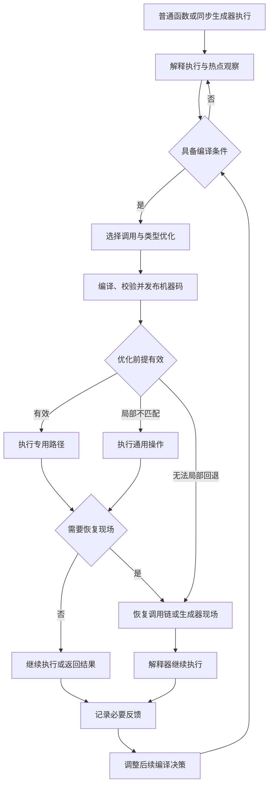
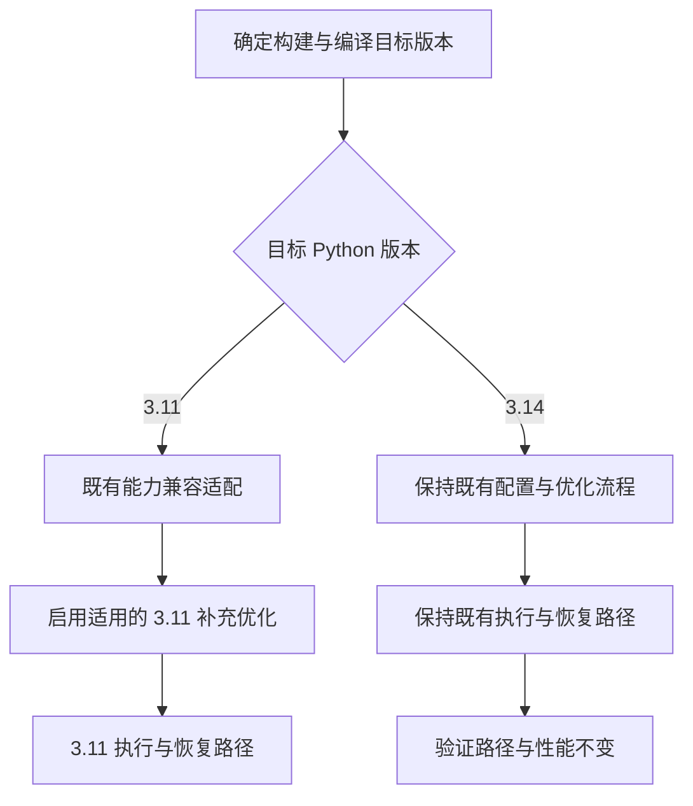
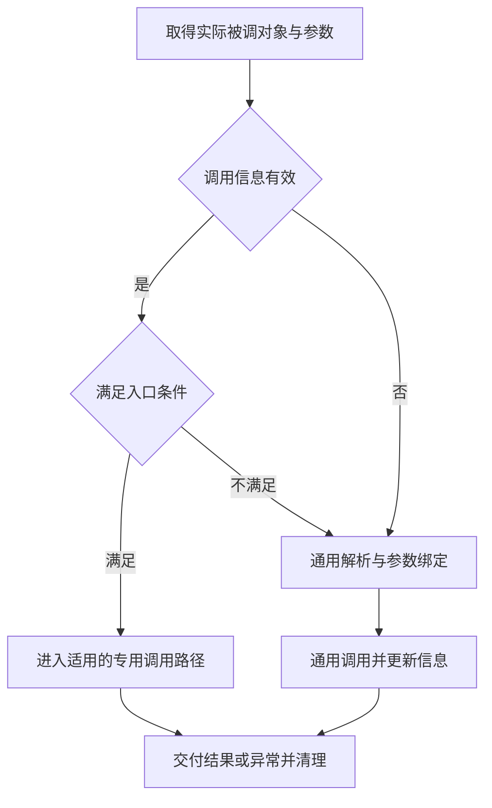
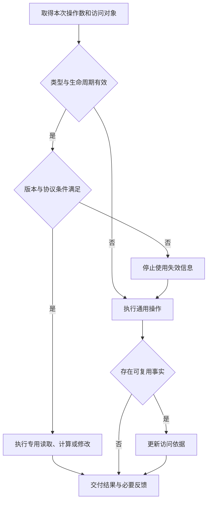
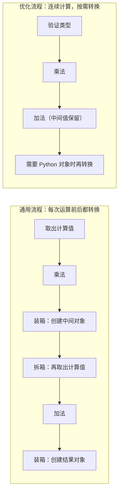
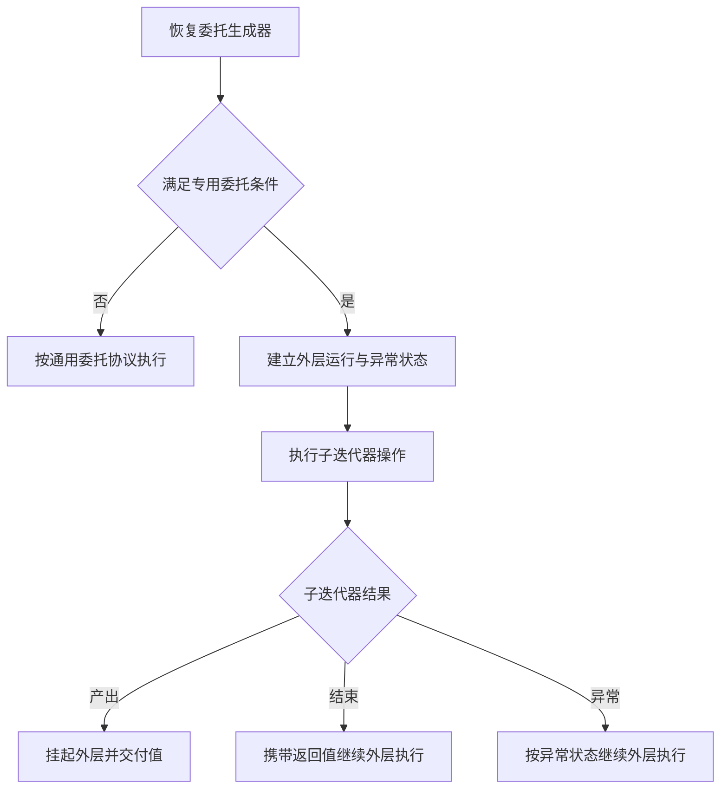
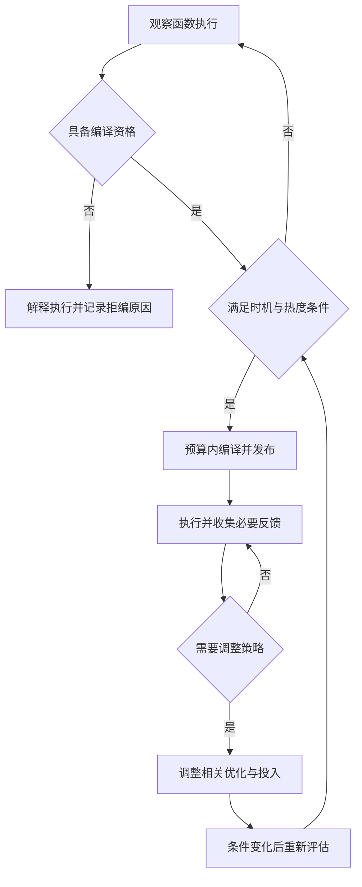
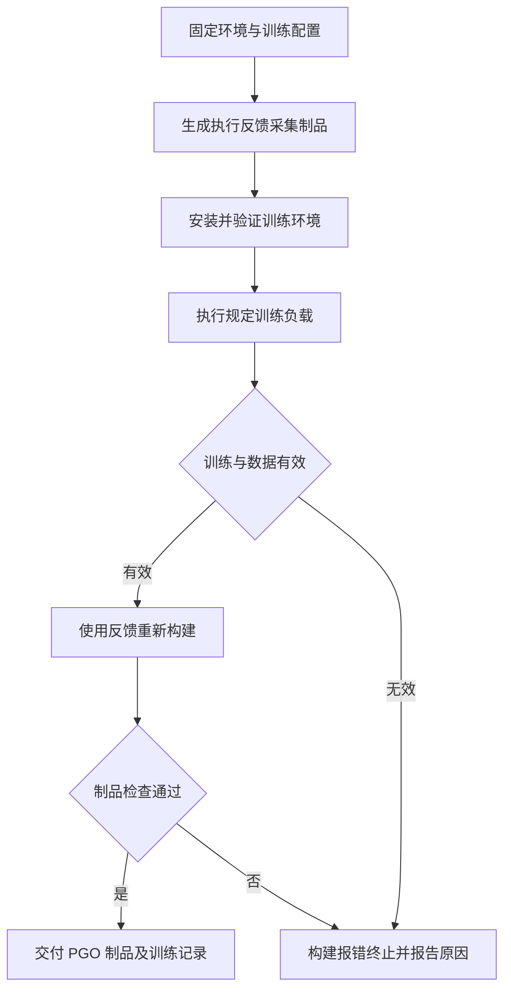

# RFC：【性能】CPython 3.11 JIT 性能优化

**状态（Status）：** Draft

**作者（Authors）：** jiabiao_o

**创建日期（Created）：** 2026-09-07

**更新日期（Updated）：** 2026-09-08

---

# 1. 概述

## 1.1 简介

本提案面向 openEuler 24.03-LTS-SP3、CPython 3.11.6 和 AArch64 环境，目标是将 CinderX 在 CPython 3.14 上已经积累的性能优化能力适配到 CPython 3.11，并补充该版本特有的优化。设计范围覆盖函数调用、Frame（函数执行现场，包括局部变量与调用关系）管理、函数内联、对象与数值操作、容器与生成器执行、编译效率、自动编译策略，以及 PGO（Profile-Guided Optimization，反馈导向优化：利用训练运行采集的执行数据指导构建产物的生成）训练与构建。

方案的总体思路是"复用为主、补充为辅"：调用与内联机制、编译产物管理、属性与方法缓存、数值优化、生成器运行时和 PGO 流程均来自既有体系；本提案重点解决这些能力在 3.11 上的使用条件、失效处理和执行现场恢复问题。对既有规则尚未覆盖的业务场景，再单独设计 3.11 补充优化。

**CPython 3.14 不受影响是本提案的硬约束：** 3.14 的默认配置、编译与执行路径及性能特征必须保持原样。为此，3.11 的兼容处理、额外守卫、策略状态和 PGO 配方都不得进入 3.14 的既有路径；确需改动 3.14 通用优化的问题，另行立项设计，不纳入本提案。具体的隔离要求见 3.1.6。

所有优化共同遵守一条正确性立场：业务代码的写法保持不变，函数的返回值、异常、用户回调和清理行为也必须与解释执行完全一致。因此，本文各节在描述一项优化时，都会同时回答三个问题：开销来自哪里、适用条件是什么、条件不满足时如何回退。

**文档结构：** 第 1 章界定问题与目标；第 2 章从典型业务场景归纳用例；第 3 章是方案主体——3.1 给出总体架构、能力边界与 3.14 隔离原则，3.2 说明关键技术取舍，3.3 按功能域展开设计，3.4 与 3.5 覆盖 DFX 与配置面；第 4-6 章列出风险、可复用的现有技术与待决问题。专业术语在首次出现处随文简要解释，完整定义见附录 B。本文只定义功能范围、总体流程、兼容性约束和测试场景；内部接口、数据结构、指令生成方式、优化规则清单和参数取值由后续详细设计确定。

## 1.2 动机

JIT（Just-In-Time，即时编译：在程序运行期间将热点函数编译为机器码执行）解决的是函数体自身执行效率的问题，但函数周围的运行时开销仍然存在。以一个典型循环为例：

```python
def amount(item):
    return item.price * item.quantity

total = sum(amount(item) for item in items)
```

`amount` 每次只做两次属性读取和一次乘法，但每轮循环都要完成调用准备、属性查找、对象转换等固定工作。函数体越短、循环次数越多，这些固定工作占总耗时的比例就越大。极端情况下，对于仅执行一次初始化即退出的命令行程序，编译成本无法在进程结束前收回。

本提案在适配 3.14 既有能力的基础上，重点处理以下七类场景。表中"回退"统一指：放弃专用路径，改用既有通用执行方式，程序结果不受影响。

| 典型场景 | 开销来源 | 拟采取的优化措施 |
|---|---|---|
| 循环内反复调用的小函数 | 每次调用均需完成调用准备与参数绑定，并建立和清理执行现场 | 复用有效的调用信息；满足条件时内联小函数，合并调用前后的计算 |
| 反复读取 `item.price`、调用 `item.update()` | 重复判断属性来自实例还是类、是否为描述符（参与属性访问协议的对象，如 `property`），以及如何绑定方法 | 在验证对象类型和查找规则后复用访问方式，每次仍读取实际对象的值 |
| 循环执行浮点运算和容器访问 | 数值在 Python 对象与计算值之间反复转换，临时切片对象创建后立即被使用 | 保留连续计算的中间值，消除业务无法观察的临时对象；缩短类型明确的下标操作流程 |
| 生成器每次只产出一个简单值 | 每次恢复、多层委托和提前关闭都要执行额外的运行时处理 | 缩短满足条件的恢复与转交流程；不需要执行用户清理代码时简化关闭 |
| 启动期间反复解析配置或初始化对象 | 短暂高频调用触发编译，后续使用频率很低；复杂函数的分析本身也耗时 | 区分启动与持续热点，结合函数体量决定编译时机，并减少重复分析 |
| 类型经常变化的计算位置 | 同一优化不断失败，反复恢复解释执行并触发重编译 | 使该位置采用更通用的处理方式，限制缺少新依据的重复编译 |
| 业务仍频繁执行解释器和通用对象操作 | 这些工作依赖构建生成的本地代码，运行时 JIT 无法完全替代 | 使用匹配 3.11 实际工作组成的 PGO 训练，改善本地代码的构建质量 |

上述优化仅作用于 3.11；3.14 的默认配置、运行路径和性能保持要求见 3.1.6。

## 1.3 目标

### 1.3.1 目标

1. 将既有语言操作和特化（根据已知类型或行为条件选择专用执行方式）能力按 3.11 语义接入 JIT，在正确性条件明确时扩大有效执行覆盖。
2. 复用既有调用与内联机制，适配 3.11 普通 Frame 管理和内联调用链恢复，降低调用成本。
3. 适配已有对象、数值与容器专用路径，补充 3.11 所需形态，并保持动态变异、异常及通用回退正确。
4. 在既有同步生成器协议上完成 3.11 恢复与生命周期适配，并降低推进、委托和关闭成本。
5. 复用既有编译器和自动编译框架，在 3.11 范围内补充编译效率及运行反馈优化。
6. 复用既有 PGO 流程，设计匹配 3.11 的训练、有效性检查与制品管理。
7. 建立兼容适配、3.11 补充优化和 3.14 路径隔离的测试能力。
8. 保持 CPython 3.14 的默认配置、支持范围、既有编译与执行路径不变，不引入额外运行、编译或资源成本及可归因的性能变化。

### 1.3.2 非目标

- 不重新设计前置 RFC 定义的构建基座、解释器求值入口和基础 JIT 执行语义。
- 不将 CPython 3.14 已有功能重新定义为全新功能，不以本提案调整其 Frame 模式、优化流程、自动编译默认策略或 PGO 构建行为。
- 不通过关闭或改用通用路径的方式牺牲 3.14 既有能力，也不将本期新增的 3.11 规则默认推广到 3.14。
- 不包含 OSR（On-Stack Replacement，栈上替换：将正在解释执行的循环切换为机器码执行）、多线程或后台编译、coroutine 和 async generator 的 JIT。
- 不包含 Static Python、Parallel GC、Lazy Import 和子解释器支持。
- 不扩展至其他 CPU 架构或承诺其他 CPython 3.11 微版本的二进制兼容。
- 不通过削弱对象协议、异常处理、Frame 自省、调试兼容性或资源清理要求获取性能收益。

# 2. 用例分析

第 1 章从执行引擎的角度描述了开销来源，本章将上述开销置于真实业务形态中，逐一回答三个问题：该场景受益于哪项能力、能力的适用条件是什么、条件不满足时系统如何表现。后续 3.3 节的功能设计与本章场景一一对应。

| 使用场景 | 主要操作与开销 | 优化能力 | 条件不满足时的行为 |
|---|---|---|---|
| 批量处理 | 循环调用短函数，反复读属性、计算并写回；调用和属性解析重复发生 | 调用信息复用、普通 Frame 管理优化、函数内联和属性访问优化 | 保留普通调用；属性或方法发生变化后按当前对象规则重新解析 |
| 数值与容器循环 | 连续算术、字符串/数组下标和切片引入转换及临时对象 | 连续计算、拆装箱消除和适用容器的专用处理 | 大整数、混合类型、越界及用户重载继续执行完整 Python 协议 |
| 生成器流水线与提前终止 | 简单值经过多层 `yield from`；消费者可能取少量值后关闭生成器 | 缩短恢复与转交路径，按挂起位置选择关闭方式 | 子迭代器不适用时正常委托；有 `finally` 或上下文清理时完整执行 |
| 短命程序与服务启动 | 导入、正则构造和配置解析可能短暂达到热点条件 | 启动阶段延后投入，持续热点再参与编译 | 继续解释执行；阶段结束后仍频繁调用的函数可以重新评估 |
| 长循环及类型变化的函数 | 单次调用可能包含大量工作；部分计算位置可能持续失效 | 按函数特征估计收益，按失败位置调整优化 | 无法编译的函数解释执行；局部失败尽量只影响对应操作 |
| 3.11 本地制品构建 | 解释器、对象操作、生成器及异常路径需要不同训练内容 | 复用 PGO 流程，提供代表性训练与失败处理 | 训练、反馈或制品检查任一失败时构建报错终止并报告原因，不降级为普通构建 |
| 已使用 CPython 3.14 的业务升级 CinderX | 同一工程的适配可能给旧路径增加检查、统计或改变编译选择 | 在版本边界选择 3.11 新能力，保持 3.14 既有行为 | 不使 3.14 回退至较慢的通用路径；无法隔离的改动移出本期 |

基线口径需要单独说明：3.11 的程序结果以同版本解释执行为参照，性能按启动、编译、稳态执行和资源成本分别评价；3.14 则与实施前同配置的 CinderX 比较，检查原有路径与性能是否保持。两个版本互不充当对方的基线。

# 3. 方案设计

## 3.1 总体方案

### 3.1.1 设计基线与前置依赖

本提案依赖前置 RFC 提供的构建、解释器集成和 JIT 执行语义能力。性能优化不得另建一套与既有语义不一致的调用、对象访问或恢复协议。

| 设计项 | 本提案采用的基线 | 约束 |
|---|---|---|
| 目标系统 | openEuler 24.03-LTS-SP3、AArch64 | 构建与运行环境的来源沿用前置环境锚定规则 |
| Python 版本 | CPython 3.11.6 | 不根据其他微版本或后续版本的数据布局推导兼容性 |
| 执行基座 | 自定义解释器循环及普通函数、同步生成器 JIT | 未满足编译条件时继续使用既有解释执行路径 |
| Frame 模型 | 普通实体 Frame | 本期在该模型下支持内联，不引入 Lightweight Frames |
| 正确性参照 | 同版本 Stock CPython 和前置 RFC 的兼容契约 | 调试事件等已定义的版本差异按既定范围验证 |
| 既有能力来源与保护对象 | CPython 3.14 | 复用其已有设计；保持其配置、编译与执行路径、性能不变，反向验证覆盖这些约束 |

函数内联依赖多层逻辑调用链恢复和相应的测试能力；生成器恢复与关闭优化依赖既有同步生成器状态机；对象访问优化依赖有效的类型与字典变异校验。前置条件未具备时，应保持该项优化关闭，而不影响已支持的执行方式。

### 3.1.2 功能边界与设计原则

下表列出本期在 CPython 3.11 上的适配与优化范围。各项能力的来源，以及它们与 3.14 的关系，见 3.1.5 和 3.1.6。

| 能力 | 本期设计结论 |
|---|---|
| 常见函数与方法的调用进入优化 | 支持，在入口资格和参数协议可验证时使用专用路径 |
| 普通 Frame 管理与函数内联 | 支持，包括内联调用链的异常与去优化恢复 |
| 对象、数值、容器和迭代操作优化 | 支持，按操作形态明确前提、失效与通用回退 |
| 同步生成器恢复、委托与关闭优化 | 支持，覆盖相应状态和生命周期约束 |
| 编译范围扩展、编译器提速与反馈策略 | 支持，分别控制编译资格、优化选择与编译投入 |
| PGO 训练与制品管理 | 支持，构建结果只有 PGO 成功或报错失败，不保留降级路径 |
| 定向测试与状态观察 | 支持，使用与真实执行一致的恢复协议 |
| LWF、OSR、异步 JIT、后台编译 | 不在本期范围 |

所有功能共用同一组处理约定，后文多处引用，现统一说明如下：

- **先验证、后复用。** 使用缓存信息前必须验证本次条件。例如，复用属性查找位置时仍要读取当前实例的值；类方法被替换后，不能继续调用旧方法。
- **按影响范围回退。** 根据失效的影响选择回退方式。例如，整数专用路径不满足条件时，可以只在当前位置执行通用数值操作；如果后续计算也依赖已经失效的假设，则需要恢复现场后继续解释执行。
- **保留已发生的副作用。** 用户索引转换、列表修改等操作一旦完成，回退后就应从下一步继续，不能重复执行。
- **控制优化自身的成本。** 对频繁变化的目标减少无效缓存更新，对大函数限制内联规模；没有新的运行依据时，不反复编译同一方案。各项优化都应能够单独观察。
- **核心优化默认固化。** 本期在 3.11 上交付的运行时优化（3.3.1–3.3.4）在交付构建中默认启用，不提供按项关闭的运行时开关；发现缺陷时修复缺陷，而不是关闭对应优化。针对单项优化的运行时控制只保留既有的调试相关控制，JIT 启用、自动编译策略等既有公共配置不受此条影响。按项启用或屏蔽某项优化的对照只在开发构建中进行，交付构建以独立构建或实施前的基线构建作为对照。3.14 既有的配置与开关按 3.1.6 保持不变。

新增处理仅在 3.11 中启用。即使某项优化也可能适用于其他版本，本期也不自动推广到 3.14；相关隔离要求见 3.1.6。

### 3.1.3 总体执行架构

下图说明 3.11 的编译、执行和回退流程。3.14 继续使用原有架构与执行路径。



图中"恢复调用链或生成器现场"即去优化（Deoptimization）：优化前提失效时，重建正确的执行现场并转入可继续执行的路径。PGO 则作用于解释器循环和本地运行时操作的构建过程，为图中的解释执行、调用辅助和通用操作提供更优的本地制品；它不替代 JIT 的资格检查、类型守卫和现场恢复。

### 3.1.4 功能职责与跨模块契约

| 功能域 | 负责的输入与输出 | 与其他功能域的关系 |
|---|---|---|
| 调用、Frame 与函数内联 | 根据实际函数与参数选择执行路径，维护逻辑调用链并交付结果 | 向其他优化提供可恢复的执行边界 |
| 对象、数值与容器操作 | 根据操作数与有效类型信息选择专用或通用操作 | 报告局部优化反馈，依赖统一异常和生命周期协议 |
| 迭代与同步生成器执行 | 根据当前状态和操作恢复、产出、委托或完成 | 复用调用、Frame、异常及自动编译机制 |
| 编译器与自动编译策略 | 根据函数特征、运行阶段和反馈决定编译及优化选择 | 管理编译预算，区分资格、策略和语义失败 |
| PGO 训练与构建 | 根据目标环境和训练配置生成可追踪的本地制品 | 与运行配置及功能覆盖范围保持一致 |
| 可测试性 | 控制场景与触发条件，观察路径和结果 | 为每个功能域提供正常、失效、恢复和生命周期用例 |

各功能域的配合关系可以概括为四条契约：调用优化传递实际函数和已经求值的参数；数值优化在自省或恢复时提供正确的 Python 值；对象访问回退时保留已经发生的用户操作；生成器在挂起期间保存各自状态，并在最后一次使用后释放资源。编译策略可以调整优化投入，但必须遵守这些契约。

### 3.1.5 已有能力与本次设计性质

本提案按能力的实际覆盖范围区分三类工作，避免"全部认定为已有"或"全部认定为新增"两种误读：

- **兼容性适配：** 既有能力继续使用相同目标和公共抽象，补齐 3.11 的语义、数据和运行时契约。
- **3.11 能力扩展：** 在已有机制上扩展 3.11 可消费的类型、操作形态或执行覆盖，不重建整套机制。
- **3.11 补充优化：** 现有规则不足以覆盖的算法、反馈或快捷处理单独设计，仅在 3.11 生效。

| 功能域 | CPython 3.14 或共享体系中的已有能力 | 本次 3.11 设计重点 | 设计性质 |
|---|---|---|---|
| 调用与编译产物复用 | 已有参数绑定、调用入口、函数与编译产物关联、基于代码及环境的产物查找 | 适配 3.11 调用形态、函数生命周期和入口约束，补充低开销调用路径 | 兼容适配为主，补充 3.11 调用优化 |
| Frame 与函数内联 | 已有 Frame 模式选择、HIR 函数内联和内联现场恢复；开放条件依平台与既有配置确定 | 将内联适配到 3.11 普通实体 Frame，补齐逻辑调用链及去优化恢复 | 兼容性设计，不是新建 CinderX 内联器 |
| 属性、方法、全局与特化操作 | 已有内联缓存（Inline Cache：在代码位置记录已验证的查找结果，供下次直接复用）、槽属性及其他特化操作、对象协议处理 | 适配 3.11 字节码、布局和缺少相应 watcher 的校验方式，扩展适用形态 | 兼容适配与 3.11 覆盖扩展 |
| 数值与拆装箱 | 已有数值简化、浮点优化、重复拆箱消除及部分装箱消除 | 衔接 3.11 类型与恢复表示，扩展整数等适用场景 | 既有优化适配与规则扩展 |
| 迭代与生成器 | 已有迭代、发送、挂起恢复、委托和关闭协议 | 适配 3.11 状态与生命周期，并设计专用恢复、委托及关闭提速 | 协议兼容适配加 3.11 补充优化 |
| 编译器优化与自动编译 | 已有优化流程、控制流分析、寄存器分配、热点及 ROI 相关策略 | 在 3.11 中扩展纯计算消除、位点反馈与启动/体量决策，并降低编译投入 | 框架复用，新增或扩展规则限定 3.11 |
| PGO | 已有反馈采集、训练和使用反馈重新构建的流程 | 适配 3.11 训练集合、检查与制品政策 | 构建能力适配和 3.11 训练扩展 |
| 可测试性 | 已有功能测试、编译器测试及运行时验证方式 | 增加适配正反例、3.11 新规则用例和 3.14 隔离检查 | 测试能力复用与覆盖补齐 |

这里的“已有能力”只表示可以复用相关设计，并不表示两个版本使用相同的内部表示、默认配置或输入范围。详细设计应逐项说明复用内容、版本差异和新增支持的情况。

### 3.1.6 CPython 3.14 路径与性能隔离

本期只改变 3.11 的适配与优化行为。版本选择应前置到构建、初始化或编译配置阶段；不得为 3.14 每次调用、属性访问、循环或生成器恢复增加 3.11 专用的判断、包装和状态更新。



| 隔离对象 | CPython 3.14 必须保持的内容 | 对本次设计的限制 |
|---|---|---|
| 默认配置与能力范围 | Frame 模式、内联与特化开关、编译阈值及已有支持范围 | 不因 3.11 采用普通 Frame 或不同策略而修改公共默认值 |
| 编译流程 | 既有优化阶段、调用顺序、候选选择和恢复信息规则 | 3.11 新增规则不进入 3.14 的优化流程，不额外遍历其函数 |
| 调用与运行时路径 | 原有入口、守卫、辅助操作及异常清理协议 | 不包裹为 3.11 通用入口，不增加逐次判断或回退到更慢路径 |
| 对象与生成器管理 | 原有缓存机制、布局、持有方式及挂起恢复协议 | 不用 3.11 的校验和状态处理替换 3.14 既有方式 |
| 资源和统计 | 原有分配、引用管理与统计成本 | 不为 3.14 创建或更新 3.11 专用状态，不扩大其常驻对象或缓存 |
| 构建与 PGO | 既有源集选择、编译选项、训练负载及失败处理 | 3.11 新训练与检查政策不自动改变 3.14 构建流程 |

共享文件中的适配必须限定版本。如果替换共享算法会改变 3.14 的路径，即使功能测试通过，也应改为版本专用方案，或移出本提案单独设计。是否影响 3.14，需要结合路径检查和同版本性能对照判断，不能仅凭开关关闭或 CI 通过得出结论。

## 3.2 技术选型

下表列出各设计项的候选方案与取舍理由。

| 设计项 | 候选方案 | 本提案选择 | 选择原因 |
|---|---|---|---|
| Frame 模型 | 为 3.11 适配普通 Frame 内联；引入新的 3.11 轻量 Frame 模型 | 选择普通 Frame 适配，保留 3.14 既有 Frame 配置 | 内联器可复用，版本间现场与恢复协议分别维护 |
| 调用优化 | 逐次通用解析；验证后复用目标 | 稳定目标使用较短路径；调用位置缓存容量不足时使用共享缓存；其他情况正常调用 | 小函数循环减少重复调用准备；目标频繁变化时不强制维护缓存 |
| 对象与数值优化 | 逐操作查找和转换；验证后直接处理 | 对明确类型和有效访问规则使用专用操作 | 稳定属性可复用查找方式，连续计算可减少往复转换；用户重载仍正常执行 |
| 假设失败处理 | 一律退出函数；局部回退与恢复结合 | 能在当前位置完成就局部处理，否则恢复现场 | 单次下标或类型不匹配不应导致整个函数退出；恢复时不重复已经发生的操作 |
| 编译策略 | 相同次数采用相同策略；结合工作阶段和函数特征 | 区分启动短暂热点与持续热点，结合体量和失败反馈 | 初始化调用未必再次发生，大函数与小函数的编译成本也不同 |
| 编译器优化 | 全版本修改共享优化；按目标版本扩展规则 | 3.11 扩展规则和编译过程，3.14 保持原流程 | 避免新规则改变 3.14 生成码、编译成本与行为 |
| 本地构建优化 | 改变全版本训练流程；在既有 PGO 中配置 3.11 训练 | 复用 PGO 框架，隔离 3.11 训练及检查政策 | 改善目标版本制品，保留 3.14 既有构建行为 |

## 3.3 功能与性能设计

本节按六个功能域展开，它们分别回答一个明确的成本问题：

- **3.3.1 调用、Frame 与函数内联**——"进入和退出函数"的成本；
- **3.3.2 对象、数值与容器操作**——"函数体内每个操作"的成本；
- **3.3.3 迭代与同步生成器**——"跨执行边界推进"的成本；
- **3.3.4 编译器与自动编译策略**——"优化投入本身"的成本与时机；
- **3.3.5 PGO 训练与构建**——未被 JIT 覆盖部分的本地代码质量；
- **3.3.6 可测试性**——以上能力的验证方式。

前四个域直接作用于运行时，第五个域作用于构建期，最后一个域贯穿全程。各节均按"典型场景与开销 → 处理流程 → 适用条件与回退 → 性能观察"的顺序组织。

### 3.3.1 【JIT】调用、Frame 与函数内联适配及优化

#### 3.3.1.1 典型场景、开销与适配目标

以 1.2 中的 `amount(item)` 为例：批量处理记录时，循环反复调用该仅含一行代码的函数。每次调用都要查找目标、准备参数、建立执行现场，并在返回后清理。循环次数增加后，这些准备工作可能占据总耗时的较大比例。

本节将既有的调用、编译产物复用和内联机制适配到 3.11 的普通 Frame。优化重点有二：一是减少重复的调用准备，二是在条件允许时将短函数与调用方一并编译优化（即函数内联）。3.14 的 Frame 模式、调用入口和内联规则保持不变。

| 处理方式 | 执行流程 | 可节省的工作 |
|---|---|---|
| 通用调用 | 解析目标 → 绑定参数 → 建立被调现场 → 执行 → 返回与清理 | —— |
| 优化后的调用 | 验证目标与调用条件 → 进入对应目标 → 返回并清理 | 重复的目标解析与部分调用准备 |
| 内联执行 | 验证被调目标 → 在调用方中执行函数体 → 继续执行调用方 | 独立调用的准备与返回，以及调用边界两侧的重复计算 |

无论采用哪种方式，Python 可见的函数身份、参数、调用层次和异常行为必须一致：不能内联时保留普通 JIT 调用，不能使用 JIT 时继续解释执行。

#### 3.3.1.2 调用形态与优化范围

| Python 场景 | 可减少的重复工作 | 适用条件 | 不满足时的处理 |
|---|---|---|---|
| 循环中的 `amount(item)` | 反复识别函数目标与准备相同参数形态 | 目标及编译依赖有效，参数形态可处理 | 重新解析并使用普通调用 |
| 重复执行 `item.update(value)` | 重复解析方法及创建仅为本次调用使用的绑定包装 | 方法、接收者和实例遮蔽规则可验证 | 按当前描述符与绑定规则正常调用 |
| 带默认参数或关键字参数的调用 | 重复判断相同绑定形态 | 实际参数及相关默认值仍满足条件 | 使用完整参数绑定，包括原有错误处理 |
| 调用内建函数或其他可调用对象 | 为已知调用约定增加的中转 | 实际对象的调用约定受支持 | 按该对象的通用调用协议执行 |
| 反复创建闭包、推导式函数 | 对相同代码重复编译或重复关联执行目标 | 编译依赖兼容，函数实例状态能被正确区分 | 使用当前实例可用的编译产物，或继续解释执行 |
| 小型普通函数嵌套调用 | 独立调用边界阻碍计算合并 | 目标可验证、完整现场可恢复且内联成本适当 | 保留原调用，不拒绝整个调用方 |

可变参数、用户描述符和错误参数仍由完整的绑定流程处理。创建生成器对象时可以使用满足条件的调用优化，但本期不把含挂起行为的生成器函数体作为普通函数内联（相关设计见 3.3.3）。

#### 3.3.1.3 调用进入与目标信息复用

以循环中的 `item.update(value)` 为例，运行时可以缓存方法解析结果。后续调用先检查该结果是否仍适用于当前对象和参数，再选择调用目标。每次调用仍须使用当前的 `item`，不得沿用首次调用的接收者。

调用流程如下：

1. 按 Python 的求值顺序取得本次被调对象和参数。
2. 检查缓存的目标、调用形态及其依赖是否仍然有效。
3. 若目标可使用 JIT，确认当前运行、调试、求值入口及递归条件允许进入，包括：目标代码未被替换、未启用追踪或性能分析、当前安装的求值入口仍为 JIT 预期的入口（每次调用实时比对）、递归剩余余量满足进入要求、原生调用栈尚未触及软上限。3.11 中这些检查在优化入口内直接完成，不为每次调用额外增加一层通用的入口包装。
4. 条件成立时使用优化入口；否则将同一组参数移交通用调用流程，不重新求值参数表达式。
5. 返回或抛异常后完成清理；新的解析结果满足复用条件时，再更新缓存。



业务替换类方法或设置实例同名属性后，后续调用必须重新解析目标。若同一调用位置出现的目标种类超出该位置的缓存容量，可转用进程内共享的缓存（仅 3.11），按接收者类型与名称查找，每次命中仍须校验类型版本，版本不匹配时使旧条目失效并重新解析；共享缓存也不适用时，再使用通用调用。对目标频繁变化的位置应控制缓存更新，避免缓存维护成本超过收益。

共享缓存的内容可能在执行用户代码期间被改写，包括本调用位置的重入调用重新填充同一条目。因此，命中后的后续处理只能使用查找时已经确认的结果，不得再次读取缓存内容。

#### 3.3.1.4 编译产物共享与动态变更

函数工厂通常会创建"代码相同、捕获值不同"的闭包：

```python
def make_scale(factor):
    def scale(value):
        return value * factor
    return scale
```

每次调用工厂函数都会创建新的函数实例。若相同代码被重复编译，或每个实例均重复建立执行关联，将增加准备成本。依赖条件兼容时，可以让这些实例共享机器码，但每次调用仍须读取当前实例的 `factor`，不能混用捕获值。

共享前先检查代码和编译时固定的依赖，再判断当前实例能否使用该产物。调用期间必须保证产物存活，结束后按本节末的生命周期原则清理。如果某个值参与了常量化或内联选择，还需单独验证该值；代码相同不足以证明产物可以共享。

| 运行变化 | 处理方式 |
|---|---|
| 默认参数或捕获值改变 | 未被固定的值从本次函数读取；固定依赖失效时停止使用相应优化 |
| 函数代码被替换 | 原代码的调用信息不再适用于该函数，重新选择执行方式 |
| 全局函数、名称来源或内建依赖变化 | 重新验证实际依赖；必要时局部回退或停止使用原产物 |
| 调试状态或 JIT 使用资格变化 | 后续调用按当前条件选择入口 |
| 产物停止接受新调用 | 在途调用完成前仍保持其有效，不得立即释放正在执行的产物 |

不兼容时保留该函数的独立行为，继续解释执行或按策略编译。复用失败本身不能改变业务结果，也不能为了共享而修改函数环境。

3.11 中编译产物的生命周期遵循以下原则（3.14 保持既有持有方式，见 3.1.6）：

- 普通调用期间不为产物单独增加持有关系，避免每次调用都承担该成本；正在执行的产物通过记录在途执行来保证存活，释放推迟到确认无在途执行的安全时机进行，不在对象析构、GC 回调等任意上下文中直接释放。
- 挂起的生成器自身持有其所用的产物，直到生成器结束或被回收。
- 从登记推迟释放（包括在对象析构期间登记）到最终释放的整个过程，都不得依赖可能失败的资源申请（例如内存分配）；资源紧张时也不能提前释放或遗漏释放。

#### 3.3.1.5 普通 Frame 管理与可观察边界

短函数每次进入和返回都要维护执行现场。对于只计算后返回的函数，重复整理相同状态会增加固定成本；一旦发生用户回调、异常或调试观察，运行时又必须提供正确的局部变量和调用关系。

Frame 优化保留 3.11 普通 Frame 的语义，只合并能够证明重复的准备与同步工作。没有发生变化的状态可以继续使用；进入可能观察现场的操作之前，必须补齐必要信息。无法证明安全时，仍按原有流程准备和同步。

| 场景 | 处理方式 | 必须保留的行为 |
|---|---|---|
| 短函数连续执行内部计算 | 减少重复准备和无变化的状态同步 | 保存足以恢复当前函数的信息 |
| 属性描述符、用户回调或析构可能查看调用方 | 在进入该操作前使现场一致 | 不能等回调返回后才补齐局部状态 |
| 自省、调试或异常构建调用链 | 按前置契约交付当前逻辑现场 | 函数、局部变量、调用关系和异常位置正确 |
| 正常返回或异常退出 | 完成本路径负责的清理 | 不把清理责任留给未必会执行的其他路径 |
| 去优化或 Frame 被外部保留 | 交付可独立继续使用的现场 | 外部仍使用的状态不能提前释放 |

内联减少的是物理调用工作，不能绕过逻辑递归限制。恢复为解释执行时也不能再次计算已经计入的调用层次。

#### 3.3.1.6 函数内联准入与成本控制

对 `amount(item)` 这类小函数，内联可以把属性读取和乘法合并到调用方中处理，省略独立调用的准备与返回，并为消除调用前后的重复计算创造条件：


编译器先识别被调目标，再检查参数绑定、函数体支持范围和现场恢复能力，最后评估代码规模与嵌套成本。全部条件满足时选择内联，否则保留普通调用。

| 条件 | 满足时 | 不满足时 |
|---|---|---|
| 被调目标仍是编译时选择的目标 | 执行适用的内联计算 | 在实际调用发生前转入当前目标的普通调用，或恢复后继续 |
| 函数体与参数形态受支持 | 合并执行并保留逻辑调用关系 | 只放弃该处内联 |
| 潜在异常与去优化均可恢复 | 允许该候选进入优化 | 保留调用边界，不得以减少恢复信息的方式强行内联 |
| 代码规模和编译投入在预算内 | 按收益选择候选 | 停止继续展开，递归与互相递归也按此处理 |

大型函数未必适合内联。若合并后显著增加编译工作与代码体积，应优先保留独立调用；内联层次和预算取值留给详细设计。

#### 3.3.1.7 内联异常与去优化恢复

例如，一个被内联的小函数先向列表追加记录，再执行可能因类型变化而失败的计算。若后一步需要回退，从头重新执行整个函数将导致记录被追加两次。因此，恢复必须从正确位置继续；若计算抛出异常，也应保留其在小函数中的逻辑位置。

恢复流程如下：

1. 判断问题发生在哪一层逻辑函数，以及该位置之前哪些操作已经完成。
2. 补齐继续执行所需的各层局部值、调用关系和异常状态。
3. 将完整有效的现场交给既有解释器恢复流程；未完成的操作继续执行，已完成操作不重放。
4. 按恢复后的正常返回或异常传播完成清理。

只有所有退出位置都具备完整恢复信息，才能启用对应内联。若编译时无法满足该条件，则保留普通调用。恢复过程中若发生资源分配等错误，则按既有错误协议退出，不交付残缺的调用链，也不从函数起点重试。

#### 3.3.1.8 性能影响与功能观察

功能用例应能区分“复用目标进入”“通用绑定”“内联被选择或放弃”和“内联后恢复”。对于工厂闭包，还应确认多个实例使用各自的值。

性能评价应覆盖大量短函数调用、方法调用和闭包创建，并用目标频繁变化及较大函数作为对照。除调用准备是否减少外，还要检查额外判断、编译时间和代码体积是否抵消收益。内联次数只反映覆盖情况，不能单独证明性能收益。

### 3.3.2 【JIT】对象、数值与容器操作适配及优化

#### 3.3.2.1 典型场景、开销与适配目标

上一节降低了"进入函数"的成本，本节处理"函数体内每个操作"的成本。以订单处理循环为例：

```python
total = 0.0
for item in items:
    total += item.price * item.quantity
```

一次 `item.price` 读取，通用流程可能需要判断值来自实例还是类、是否经过描述符、是否存在自定义访问行为。对象类型与访问规则长期稳定时，反复执行整套解析即构成可优化的开销。数值计算和容器操作也存在类似的重复类型判断与转换。

本节将既有属性、方法、数值和部分拆装箱（在 Python 对象与裸计算值之间转换）优化适配到 3.11，并扩展构造、下标和切片等场景的支持范围。新增的检查与恢复处理仅用于 3.11，不进入 3.14 原有路径。

| 常见操作 | 重复工作 | 优化方式 |
|---|---|---|
| `item.price`、`item.update()` | 判断属性值来源与方法绑定方式 | 验证规则仍有效后复用查找方式 |
| `Point(x, y)` | 反复查找创建和初始化行为、准备一般形式的调用 | 对规则稳定的普通类缩短构造流程 |
| 连续数值表达式 | 反复将中间结果转换为 Python 对象，再取出计算值 | 计算期间保留中间值，在需要 Python 对象时再转换 |
| `values[i]`、`text[start:stop]` | 通用派发、索引转换和临时切片对象创建 | 类型明确且满足边界条件时，缩短操作流程 |
| 用户类下标 | 每次重新查找该类型的读写方法 | 验证方法未变后复用解析结果，仍调用当前用户方法 |

#### 3.3.2.2 特化依据与通用处理流程

此前观察到的类型信息可用于指导编译器选择优化，但后续输入仍可能发生变化。因此，每次操作都要检查必要的类型与有效性条件：成立时执行专用路径，否则回到该操作的通用规则。

两种流程的区别在于是否重新完成查找或转换：

- 通用流程：识别操作 → 完整查找或转换 → 执行操作。
- 优化流程：验证缓存的条件 → 复用查找结果或计算方式 → 执行操作。

条件失效后必须重新解析，不能继续使用旧信息。



回退方式遵循 3.1.2 "按影响范围回退"原则：如果类型不匹配，但当前操作仍能通过通用流程完成，就在当前位置回退；如果后续计算也依赖已经失效的假设、无法局部处理，则恢复现场后继续解释执行。两种方式都不得重复已经发生的用户操作。

#### 3.3.2.3 属性、方法与全局访问

多个同类对象读取 `item.price` 时，可以复用属性的查找方式，但不能复用特定实例的属性值。查找位置不变并不意味着取值不变：业务更新属性后，下一次读取必须读取到新值。

| 场景 | 优化处理 | 适用条件 | 失效后的处理 |
|---|---|---|---|
| 普通属性与 `__slots__` 读取 | 验证查找规则 → 读取当前对象的值，减少重复解析 | 对象类型、访问规则和属性存在性满足要求 | 属性删除、类型或描述符变化时重新查找；不存在则产生正常异常 |
| 初始化中的首次赋值与后续覆盖写 | 复用可用的存储方式，分别处理新增和替换 | 写入规则、存储条件和对象状态适用 | 条件变化时执行通用赋值，保留自定义赋值行为 |
| `item.update()` 方法调用 | 复用类侧方法解析；在允许时不创建仅供此次调用的绑定包装 | 当前实例没有改变遮蔽关系，描述符和方法仍适用 | 同名实例属性、方法替换或描述符变化后重新解析 |
| 类属性与类方法 | 复用类、继承和元类查找中可验证的部分 | 没有被忽略的动态元类或描述符行为 | 重新使用当前查找与绑定规则 |
| 全局、模块和内建名称 | 验证名称来源，再取当前值；已固定的值另行验证 | 来源和所依赖的值条件仍成立 | 删除或遮蔽关系变化时重新解析，不能沿用原来源 |

3.11 将沿用前置 RFC 的命中时有效性检查方式。类型、字典和对象可能在用户描述符或回调中改变，因此调用用户代码之后，还要重新确认后续操作依赖的事实。

属性插入不能视为对已有值的简单覆盖，仍需保持字典中可观察的插入顺序和对象可达性。缓存探测本身也不能为提高命中率创建实例字典或触发用户属性协议。

#### 3.3.2.4 对象构造优化

批量创建 `Point(x, y)` 时，普通构造需要判断创建行为、分配对象、解析初始化方法并准备调用。若类始终采用受支持的普通创建方式，重复解析的部分即可复用。

优化后的构造流程依次验证类的创建与初始化规则、创建对象、使用实际参数初始化，最后检查结果并返回。对象创建和初始化都必须完整执行，减少的只是重复解析与不必要的调用准备。

| 条件或事件 | 设计处理 |
|---|---|
| 类的创建、分配和初始化方式均受支持且未变 | 使用专用构造流程 |
| 自定义元类、创建规则或复杂调用不在支持范围 | 在对象创建前进入通用构造 |
| 初始化方法在运行中被替换 | 后续构造重新解析，不能继续调用旧方法 |
| 创建失败 | 传播错误，不调用初始化 |
| 初始化抛异常或返回不允许的结果 | 按原构造规则报错和清理，不再次创建或初始化对象 |

只允许在用户可见操作尚未执行时从头转入通用构造。对象已经创建或初始化已经开始后，后续错误应从当前位置处理，避免一次业务调用创建或初始化两次。

#### 3.3.2.5 数值运算与拆装箱

以下循环体现了连续浮点运算场景：

```python
total = 0.0
for value in values:
    total = total + value * 0.5
```

按逐项处理的通用流程，乘法结果可能先被包装成 Python 对象，随后又由加法取出计算值，下一轮循环将重复此过程。对于满足精确类型要求的计算，可以在连续运算之间保留中间值，减少往复转换：



优化流程中的转换时机是：返回结果、写入业务可访问的容器、调用用户代码或恢复现场需要 Python 值时。

| 数值场景 | 适用条件与优化 | 不满足时如何处理 |
|---|---|---|
| 较小的精确整数连续运算 | 能证明所选计算方式保持准确结果时减少对象转换 | 超出范围时转完整整数运算或恢复后继续，不能截断结果 |
| 精确浮点运算 | 在保持 Python 运算顺序和语义的条件下连接计算 | 类型变化后使用通用处理；特殊值和异常仍按原规则处理 |
| `value += delta` | 确认该类型的原位规则允许相应优化 | 自定义原位行为、可变对象及重载按完整协议执行 |
| 比较后立即判断条件 | 复用有效的数值比较结果，减少中间转换 | 用户比较协议或类型不适用时正常调用，不额外执行比较 |
| 仅为恢复现场保留的临时结果 | 不被业务观察时可省略正常路径对象创建 | 自省、异常或去优化需要该值时重建正确 Python 值 |

精确内建类型与子类分开判断；混合数值类型、反射运算、大整数和用户重载不能按简单算术处理。浮点优化也不能以数学上的等价改写替代 Python 的实际运算顺序。

如果中间对象会被业务保存、比较身份或交给用户代码，就不能仅因数值相同而删除。具体可消除形态和范围证明由详细设计给出。

#### 3.3.2.6 下标、切片与用户类操作

`text[start:stop]` 通常先创建切片对象，再由下标操作读取范围并取出内容。如果切片仅被紧邻的操作使用，就可以直接传递范围，省略该临时对象。实际返回的字符串或容器仍按 Python 语义生成。

| Python 场景 | 优化流程 | 不满足条件时的处理 |
|---|---|---|
| `values[i]` 或 `values[i] = value` | 确认容器与索引条件 → 处理负索引及边界 → 读写 | 类型、布局或索引不适用时执行通用下标；越界仍产生正常错误 |
| `text[i]` | 对适用字符串与整数索引减少通用转换和派发 | 用户子类、自定义索引等按其协议处理，仍保持字符语义 |
| `text[start:stop]`、列表或元组的切片 | 直接使用仅供本次操作消费的范围，减少临时切片对象 | 步长、重载等不受支持，或切片需要单独保存时，使用通用流程 |
| `matrix[row]` 等用户类操作 | 验证实际类型及其读写方法未变 → 调用当前方法 | 方法变化或不受支持时重新解析；不能用实例同名属性替代特殊方法查找 |
| 切片赋值与自赋值 | 在保留右值求值和目标修改顺序的前提下减少准备 | 扩展步长、长度要求或自定义行为按完整赋值协议处理 |

索引转换可能执行用户代码。例如，自定义索引在转换过程中修改了目标列表，后续访问就必须根据修改后的列表处理。此时可以放弃专用路径，但不能为了重试而再次执行索引转换。

#### 3.3.2.7 真值、字符串与类型判断

真值、字符串和类型判断本身通常很短，通用派发与中间转换可能占据较大比例。优化范围及回退条件如下：

| 场景 | 减少的工作 | 适用条件与回退 |
|---|---|---|
| `if value`、`not value` | 对明确内建类型减少通用真值派发 | 自定义布尔/长度行为必须正常调用，错误返回和异常仍保留 |
| 字符串相等与包含判断 | 对适用精确字符串减少包装与重复类型选择 | 子类、重载或不适用的字符串形态交给正常协议 |
| `isinstance(value, Expected)` | 在判断依据完整时缩短常见肯定或否定结果的处理 | 存在自定义类型判断或可观察类信息时转入通用流程；直接类型不同不足以直接判否 |

例如，用户对象的布尔判断会增加一个计数器，优化后也必须执行一次，且只能执行一次。缩短协议派发流程不能省略或重复业务定义的行为。

#### 3.3.2.8 失效、慢路径与引用所有权

回退前须区分两种状态：操作尚未执行，或已经执行了部分用户代码。前者可以直接交给完整的通用流程；后者必须保留已经发生的结果与副作用，从正确位置继续。

| 事件 | 继续方式 |
|---|---|
| 操作前发现类型或查找规则不适用 | 不读取旧缓存内容，使用当前对象的通用操作 |
| 描述符、索引转换或用户回调已经执行 | 保留其结果与副作用；重新确认之后需要使用的条件 |
| 局部操作仍能正确完成 | 在当前函数内完成通用处理，必要时更新可复用信息 |
| 后续计算依赖的假设已无法局部修正 | 恢复 Python 可见现场后继续执行 |
| 正常返回、错误或恢复后退出 | 完成本路径的临时对象和持有关系清理 |

缓存中的函数、类型或值只能在生命周期有效时使用；失效检查失败后不能再读取旧对象。减少引用操作或利用对象复用时，仍要保持 GC 可达性、用户可观察的清理行为及调试构建的引用计数规则。

#### 3.3.2.9 性能影响与功能观察

目标场景是稳定对象批处理、连续数值运算、密集下标与短切片操作。相应对照应包含类型频繁变化、用户协议占主导及边界输入，以确认额外判断和缓存维护没有使通用处理承担过高成本。

功能测试需要确认专用路径、属性变更后重新解析、边界回退以及消除的值被恢复等事件。性能评价则分别观察重复解析、转换、临时分配和长期缓存占用，不应将全部改善笼统归因于"JIT 加速"。

### 3.3.3 【JIT】迭代与同步生成器适配及优化

#### 3.3.3.1 典型场景、开销与适配目标

前面的优化均发生在一次连续执行之内；生成器则将执行划分为多次"恢复—产出—挂起"，由此产生中转成本。以下生成器每次仅完成一次简单计算并产出一个值：

```python
def scaled(values):
    for value in values:
        yield value * 0.5
```

消费者每取一个值，都需要推进迭代器、恢复生成器、执行到下一次产出，再恢复挂起状态。若外层还有多层 `yield from`，同一个值还可能经过多次外层恢复和转交。函数体越简单，此类固定开销越具优化价值。

本节复用既有迭代与生成器协议，适配 3.11 的状态、异常和 Frame 恢复，减少重复中转与准备工作。产出、返回、异常、关闭和清理行为保持一致。3.14 的恢复与对象管理方式不变，本期也不扩展 3.11 的异步 JIT 范围。

| 场景 | 主要开销 | 优化重点 |
|---|---|---|
| 内建迭代器被密集推进 | 每步重复选择推进方式并包装结果 | 适用协议的重复派发 |
| 简单生成器持续恢复 | 多层恢复入口和重复状态准备 | 已能确定的中转与重复准备 |
| 多层 `yield from` 持续产出 | 每个值都逐层进入只负责转交的外层 | 无需执行外层后续逻辑时的重复进入 |
| 生成器只消费少量值后关闭 | 为完成简单清理恢复执行现场 | 能证明无需运行内部用户清理时的恢复成本 |

#### 3.3.3.2 迭代推进与结束处理

对于 `for item in items`，运行时先确定实际迭代器的类型和推进协议，再选择对应路径。内建迭代器满足条件时，可以减少每步的包装与中转。判断条件不得依赖试探性取值，否则将改变业务实际消费的序列。

推进流程为：验证迭代对象与协议 → 推进一步 → 区分元素、耗尽和异常 → 将结果交给循环或消费者。

| 情况 | 处理方式 |
|---|---|
| 迭代器和当前状态适用 | 使用较短的推进路径，交付本次元素 |
| 用户迭代器或不适用的类型 | 调用该对象当前的通用推进协议 |
| 正常耗尽 | 按当前迭代协议结束，不重启迭代器 |
| 推进产生其他异常 | 传播异常，不得将其视为正常结束而忽略 |
| 迭代期间容器变化 | 保持该容器原有的允许行为或错误规则 |

连续对已耗尽对象操作、空迭代器及推进中执行用户代码都应有对应测试。优化只减少推进的准备成本，不改变每次推进产生的业务效果。

#### 3.3.3.3 生成器恢复流程与状态转换

以 `scaled(values)` 为例，恢复时需要检查对象状态、准备挂起现场和异常上下文，再继续执行函数体。对象、挂起状态和调试条件明确时，可以缩短入口中转，但仍须完整维护运行、挂起和结束状态。

流程对比如下：

- 通用恢复：逐层识别与派发 → 准备现场 → 执行 → 返回结果。
- 优化恢复：确认条件 → 进入对应恢复过程 → 准备必要状态并执行 → 返回结果。

| 当前状态与操作 | 处理方式 | 不满足条件时的行为 |
|---|---|---|
| 未启动时 `next` 或 `send(None)` | 按首次进入规则开始执行 | 不能将首次进入视为已有挂起点的恢复 |
| 未启动时 `send(非 None)` | 保持原有错误行为 | 不因专用入口存在而直接执行函数体 |
| 挂起时正常 `next/send` | 条件满足时缩短恢复路径 | 调试条件或挂起状态不适用时使用兼容恢复 |
| 挂起时 `throw` | 在支持该操作的路径中交付异常 | 无法证明专用处理正确时使用完整异常协议 |
| 运行中重入 | 拒绝重入 | 原在途执行状态不被覆盖 |
| 已结束后继续操作 | 按相应结束协议处理 | 不重新启动函数体 |

产出的值交给消费者之前，必须完成对外可观察的挂起状态；正常结束和异常结束则分别清理。恢复途中若不再满足专用条件，应在正确的协议位置转入兼容处理，不得从头重新执行生成器函数体。

#### 3.3.3.4 多层委托优化

典型场景是只负责转交值的包装层：

```python
def wrapped(source):
    result = yield from source
    record_result(result)
```

当 `source` 连续产出时，`record_result` 尚不需要执行。满足委托条件后，可以直接转交子迭代器产出的值，省略每次重新进入外层、判断委托是否结束、再转交值的过程。

通用流程中，子迭代器产出后，要重新进入外层完成转交。优化流程先验证委托关系，随后在维护外层挂起状态的同时直接交付值。子迭代器结束或抛异常时，才继续执行外层后续逻辑。



适用条件包括委托关系、子迭代器状态及本次操作受支持，并能完整保持外层的运行、重入和异常语义。子迭代器结束后必须把返回值交给外层，继续执行示例中的 `record_result`；抛异常时也必须进入外层应执行的异常处理。

任一层不适用时，该层仍使用通用委托。`throw` 和 `close` 若不属于专用范围，则使用完整协议，不得借用正常产出的捷径跳过异常或清理行为。

#### 3.3.3.5 关闭、提前丢弃与最终清理

例如，业务找到第一条匹配记录后就显式关闭生成器，或释放它使其进入最终清理。若挂起位置之后不需要执行用户清理，为了结束对象而恢复整个执行现场可能产生额外成本；若生成器处于 `try/finally` 或 `with` 中，该步骤不可省略。

关闭时先判断当前状态和是否需要执行用户清理，再处理必要的子迭代器关闭。满足快速关闭条件时直接清理；否则恢复生成器，执行完整关闭协议，最后释放相应资源。

| 场景 | 适用处理或回退 |
|---|---|
| 未启动且协议不要求执行函数体 | 按未启动关闭规则完成状态与资源处理 |
| 挂起位置满足快速关闭条件 | 不恢复无须执行的函数体，直接完成允许的清理 |
| 包含 `finally`、上下文管理或其他用户清理 | 恢复至相应处理，让清理逻辑正常执行 |
| 正在委托子迭代器 | 先按协议处理子迭代器，再判断外层可否简化 |
| 子迭代器关闭抛异常 | 保留异常和已发生的操作，按关闭协议继续，不能再次关闭以试图消除错误 |
| 弃引或 GC 引发最终清理 | 保持既有最终清理与对象复活规则，不提前把对象视为完全结束 |

“当前没有运行”不足以证明能快速关闭。必须结合挂起位置和清理要求做判断；不确定时选择完整关闭流程。用户清理已经发生一部分时，回退从正确位置继续，不从关闭过程起点重放。

#### 3.3.3.6 挂起期间失效与现场恢复

同一函数可以同时创建多个挂起生成器。业务关闭该函数的后续 JIT 入口后，已经创建的对象仍应从各自挂起位置继续，不能因为不再接受新调用就释放它们仍在使用的代码和现场。

后续新调用重新选择入口，已经挂起的对象则继续保留所需资源。如果某个对象需要转为解释执行，应先恢复它自己的局部值、委托关系和异常状态，再执行本次操作。

适用恢复信息不足时，不应启用对应的生成器优化。恢复过程中出错时按既有错误处理退出，不把对象替换成新实例，也不重新消费已经产出的元素。

测试应覆盖多个实例交错恢复、挂起期间自省和 GC、调试状态变化，以及最后一个对象结束后的资源释放。

#### 3.3.3.7 自动编译准入与性能观察

持续产出上万个值的生成器，与取值一次就关闭的生成器，能够摊销的编译成本不同。因此，编译决策需要综合创建频率、实际恢复次数、函数体工作量和生命周期，不能仅依据对象的创建数量。

策略只能观察真实业务操作，不得额外启动或推进生成器收集数据。暂不编译时继续解释执行，在满足条件的后续创建调用中再评估；已经开始解释执行的生成器不因新产物生成就转入机器码。

功能观察应区分专用/通用恢复、委托值转交、委托结束后的外层执行和快速/通用关闭。性能测量分别覆盖完整消费与提前终止、单层与多层委托，并记录创建编译成本和挂起对象占用。

### 3.3.4 【JIT】编译器与自动编译策略适配及优化

#### 3.3.4.1 典型场景、开销与决策边界

前几节降低了执行的开销，本节处理"优化投入本身"的开销。一个命令行工具可能在启动时多次解析配置，随后即退出；服务中的小函数则可能在启动后被长期调用。两者均可能达到相同的调用次数阈值，但前者可能无法在进程结束前收回编译成本，后者更具投入价值。

编译本身还需要分析控制流、选择优化、安排计算值的存放和生成代码。若对同一函数反复执行无效分析，或优化失败后立即重新编译同一方案，累计成本亦会增加。

本节在现有编译与自动编译框架中，分别处理以下问题。新增规则仅作用于 3.11；3.14 的优化顺序、分析方式、阈值和反馈策略保持不变。

| 需要回答的问题 | 判断依据 | 不满足时的处理方式 |
|---|---|---|
| 能否正确编译 | 语言操作、控制流、异常与恢复是否受支持 | 继续解释执行，不能用热度绕过资格检查 |
| 现在是否值得编译 | 运行阶段、持续调用、循环特征及编译投入 | 暂缓并继续观察，而非永久拒绝 |
| 应使用哪些优化 | 类型与调用目标是否稳定，代码规模是否合适 | 保留通用编译形式或普通调用 |
| 某项优化是否还值得维持 | 失败位置、原因、频率及实际成本 | 调整相关优化，避免反复生成同一失败方案 |

#### 3.3.4.2 语言操作覆盖与编译资格

例如，一个热点函数的大部分工作是数值循环，但冷路径中包含字符串格式化或函数内导入。如果不能正确编译这一操作组合，整个函数可能只能解释执行。扩大覆盖的目的，是使这些常见组合在保留完整语义的前提下进入 JIT，而非要求所有操作均采用专用快速路径。

| 典型 Python 操作 | 支持范围 | 需要保证的行为 |
|---|---|---|
| 下标读取、写入与删除 | 允许适用专用操作与通用对象协议组合编译 | 子类或用户对象不适用时仍能调用正常协议 |
| `and/or` 与条件表达式 | 保持短路决定哪些表达式会执行 | 不能提前求值原本不会执行的表达式 |
| 全局赋值与闭包更新 | 写入后后续代码读取新值 | 使依赖旧值的优化及时失效 |
| 切片、格式化与字符串组合 | 表达正常处理、用户协议与异常 | 无法特化时使用通用操作，不额外调用用户协议 |
| 函数内导入 | 执行需要的导入及后续名称使用 | 保留导入异常与副作用，恢复时不重复已完成的导入操作 |
| 数值循环与容器组合 | 保留循环状态、异常和异步事件检查 | 边界输入可局部处理或恢复，不能删去必要检查 |

编译资格检查先确认可达操作及其组合受支持，再检查异常处理与现场恢复是否完整，最后选择专用或通用形式生成产物。缺少类型信息时，可以优先采用通用操作；如果整个组合无法正确处理，则在发布产物前拒编，继续解释执行。

#### 3.3.4.3 类型信息收集与编译时序

例如，函数第一次收到整数，后续业务却主要传入浮点数。若过早将整数类型固定为唯一情形，可能导致反复回退；若持续等待类型稳定，又将错失部分热点执行机会。

编译时机与优化形式分别决策。类型信息稳定时，选择相应的专用操作；信息不足但已经值得编译时，保留通用操作，或生成带局部回退的类型判断。

| 观察情况 | 编译选择 | 类型变化后的处理 |
|---|---|---|
| 常见输入类型稳定 | 在有效性检查保护下采用专用操作 | 局部回退或恢复，并记录相关反馈 |
| 调用已持续变热，但类型仍混合 | 采用通用或有限类型选择的编译形式 | 继续按实际输入执行，不要求整个函数反复退出 |
| 尚不能摊销编译投入 | 继续解释执行并观察 | 后续满足条件再评估 |
| 信息读取时已失效或不一致 | 放弃使用该信息 | 保留通用处理，不固定未经验证的假设 |

收集信息不能额外执行函数、读取会触发业务行为的属性或推进生成器。使用历史信息仅用于选择优化候选，当前操作仍需验证相关条件。

#### 3.3.4.4 公共子表达式与冗余检查消除

对同一个数值连续计算时，多个操作可能反复检查类型、拆出计算值，或重复计算同一结果。例如：

```python
left = value + 1
right = value + 1
```

如果 `value` 是满足条件的精确整数，且业务无法观察中间对象的身份，可以复用这次纯计算。如果它是自定义对象，加法会记录日志或返回不同对象，就必须保留两次操作。

消除重复计算前，需要确认操作数相同、不会改变用户行为，而且之前的结果在所有到达当前位置的路径上都有效。条件成立时复用结果或删除重复检查，同时保留异常与恢复所需的信息；无法证明时保留原操作。

| 场景 | 可否减少重复工作 | 原因与处理 |
|---|---|---|
| 同一不可变数值的重复转换 | 在转换规则相同且此前结果必然存在时允许复用 | 避免再次检查和转换同一值 |
| 已验证条件之后再次检查同一条件 | 保证仍有效时允许省略重复检查 | 不能省略首次验证 |
| 某项计算只在 `if` 的一侧执行 | 其他可达路径不能直接复用该结果 | 该路径可能未执行过前述计算 |
| `before = obj.value`，调用用户函数后再读 `obj.value` | 不能仅凭对象与名称相同合并读取 | 用户函数可能改变属性或描述符 |
| 数值相同但对象身份或操作次数可被观察 | 不删除对应对象或用户操作 | 结果相等不代表 Python 行为相同 |

本节在已有简化和重复拆箱消除规则上扩展 3.11 的支持范围。具体规则及其正确性证明由详细设计给出，3.14 的优化阶段与执行顺序保持不变。

#### 3.3.4.5 编译分析与资源管理提速

当程序包含许多函数，或某个大函数需要多轮优化时，编译器会重复遍历程序、整理计算值的使用范围并申请临时资源。即使最终生成的机器码完全相同，这些准备工作也会影响启动和预热时间。

编译过程从三个方面降低成本：没有候选时跳过不必要的分析；在同一次编译中复用仍然有效的结果；将可以批量处理的工作集中完成。

| 编译工作 | 开销来源 | 优化方式 | 不满足条件时的处理 |
|---|---|---|---|
| 控制流与可达性分析 | 多轮优化中反复建立完整分析，但本轮没有待处理内容 | 先判断是否有候选；可证明仍有效时复用分析 | 程序结构已变化则重新分析 |
| 优化遍历 | 某类规则已无法产生变化，却继续完整扫描 | 在保证依赖已满足时跳过无效工作 | 其他变化可能产生新候选时重新执行必要遍历 |
| 计算值使用范围与寄存器分配 | 每加入一项工作就反复整理已有结果 | 对适合一次处理的部分批量整理 | 依赖前一步结果或无法保证等价的情况保留原处理 |
| 临时资源 | 编译大量函数时反复申请与释放短期工作空间 | 在隔离的编译任务内复用适用空间 | 无法复用时正常申请，失败按既有错误处理清理 |
| 编译中断与结束 | 失败后残留分析或资源，后续编译继续积累 | 明确各退出方式的释放责任 | 不保留可能污染下一次编译的未完成状态 |

具体内部表示和分配算法由详细设计决定。本期的优化只选择 3.11 路径；若必须无条件替换全版本算法，无法保留 3.14 原有行为，则移出本提案。

#### 3.3.4.6 启动阶段与编译时机

典型对照是"启动时反复构造正则或读取配置"与"服务启动后持续处理请求"。前者仅在短时间内呈现热点特征，后者拥有更多执行机会以收回编译成本。

编译决策依次考虑运行阶段、实际执行频率、函数体量和循环特征。收益依据充分且预算允许时发起编译，否则暂缓并继续观察。

| 场景 | 编译决策 | 后续行为 |
|---|---|---|
| 导入、初始化或启动宽限阶段 | 延后对短暂热点的投入 | 阶段结束后仍持续使用的函数可以重新积累和评估 |
| 小函数持续被调用 | 在资格成立后较早参与编译 | 仍遵守资源预算和正确性条件 |
| 大函数偶尔调用 | 要求更多收益依据，避免少数调用触发高额编译 | 使用频率提高后允许重新评估 |
| 一次调用内有长循环 | 在进入函数前的判断中考虑其潜在工作量 | 本期不在已经运行的解释器循环中切换为 JIT；后续调用可受益 |
| 创建子进程 | 建立适合子进程的阶段与决策状态 | 不机械沿用父进程已过期的启动判断或待处理预算 |



暂缓不是永久排除。状态何时改变、何种条件允许重试必须可查询和测试；具体阈值与时间参数留给详细设计。

#### 3.3.4.7 失败反馈、退出范围与受控重试

例如，一个函数的大部分位置始终处理浮点数，只有一处偶尔收到其他对象。若因该位置失败而使整个函数反复退出并重新编译，其他稳定位置的收益亦将受损。因此，反馈应优先用于调整发生问题的位置，并限制重复尝试同一失败方案。

| 事件 | 处理方式 | 回退范围 |
|---|---|---|
| 偶发类型不匹配 | 本次通用执行，积累必要反馈 | 优先只影响该次操作 |
| 同一假设持续失败 | 判断继续检查是否值得 → 调整该位置的专用化 → 必要时重新编译 | 不无依据地去掉函数内其他有效优化 |
| 程序使用异常表示正常控制流 | 按异常语义执行，再结合成本判断是否值得优化 | 不仅凭有异常就停止编译整个函数 |
| 函数或环境被替换 | 停止使用已不适用的后续入口，重新选择执行方式 | 保留在途调用所需资源 |
| 编译超出投入预算 | 暂停进一步投入，等待明确变化条件 | 解释执行或继续使用仍有效的产物 |

重试前需要新的依据，例如输入分布变化或持续热度提高。没有新依据时保留较通用的方案，不得重复生成预期同样失败的机器码。次数、等待规则和采样方式由详细设计规定。

#### 3.3.4.8 观察开销与配置约束

热点计数和失败反馈会跟随业务反复执行。若每次短调用都读取多项配置、记录详细日志或整理历史数据，策略自身的开销可能超过所节省的调用准备成本。

稳定配置在进程初始化时确定，常态运行只保留决策必需的信息，详细记录按需开启。允许降低采样频率的信息不必逐次完整统计。收益估计可以在规定范围内采用近似值，正确性检查则必须保持完整。

递归、调试、信号和其他异步事件仍按既有要求处理。测试应可控制阶段、阈值与反馈条件，验证从观察到编译、调整和重试的过程；不得依赖特定机器长时间运行来构造用例。新观察机制仅作用于 3.11。

### 3.3.5 【构建】PGO 训练与构建适配

#### 3.3.5.1 典型场景、开销与适配目标

即使业务热点全部进入 JIT，导入、对象创建、通用属性操作、异常恢复和不适用 JIT 的函数仍会执行解释器或本地运行时代码。仅缩短机器码函数体无法覆盖这部分成本，本节即针对该问题。

本节复用既有 PGO 流程，为 3.11 配置代表性训练。训练记录本地代码的实际执行情况，构建工具再利用这些反馈优化目标制品；运行时生成的机器码仍由 JIT 自身优化，两者分工互补。

普通构建直接根据编译配置生成制品。PGO 构建则先生成用于采集反馈的制品，运行代表性负载，检查反馈有效性，再利用反馈重新构建并完成制品检查。

适用前提是训练对应目标 3.11 环境、JIT 配置和主要工作组成。训练、反馈或制品检查任一环节失败，构建即报错终止并报告原因，不降级为普通构建。3.14 的训练、构建选项和失败行为不变，也不消费 3.11 的数据。

#### 3.3.5.2 训练负载与覆盖范围

如果训练只执行数值循环，没有覆盖生成器和异常处理，所得反馈就难以代表依赖这些功能的程序。因此，训练内容应反映目标业务的主要操作，而不应仅选择容易进入 JIT 的函数。

| 训练场景 | 需要实际执行的行为 | 主要覆盖目的 | 具体训练场景 |
|---|---|---|---|
| 批量对象处理 | 创建对象、调用方法、读写属性 | 训练入口与对象操作相关本地路径 | 批量对象处理（普通类、`__slots__` 类及其子类混合）；调用形态（位置、默认值和关键字参数，可调用对象、调用链及递归） |
| 数值和容器处理 | 连续计算、字符串、下标、切片及边界输入 | 同时覆盖常见操作和必要的通用处理 | 文本记录处理（字符串拆分、数值转换、集合与字典分组、排序与切片，含空值、负数和大整数边界）；标准库边界（JSON 与 pickle 编解码、日志输出） |
| 生成器流水线 | 创建、持续恢复、委托、提前关闭 | 覆盖正常产出和资源清理 | 生成器流水线（多层 `yield from` 委托、交替恢复、返回值传递）；生成器清理（抛入异常、提前关闭、`finally` 与上下文管理器清理） |
| 异常与优化退出 | 用户异常、条件失效和解释器继续执行 | 避免只训练成功处理而忽略恢复路径 | 非法输入与异常（转换失败、除零、越界、缺失键及自定义异常）；运行时变更（运行中替换类方法，参数由整数变为浮点数） |
| 启动与解释执行 | 导入、初始化和不适用 JIT 的代码 | 覆盖业务仍会支付的解释器成本 | 启动与导入（独立进程启动解释器、加载 CinderX，导入并使用标准库模块） |
| 重复创建与销毁 | 临时对象、挂起对象、释放和 GC | 覆盖分配及清理相关工作 | 临时对象（短生命周期的元组、字符串和列表）；循环引用清理（循环引用对象与挂起生成器经 GC 回收）；异步任务（协程任务创建、等待与取消） |

训练负载应有明确输入和完成条件。上述 6 类训练细化为 12 个具体场景，每个场景在独立子进程中运行，并设有完成校验和超时，各场景须达到规定的完成条件：完整消费场景应校验消费结果；提前关闭、异常注入及回收场景应校验相应的退出与清理动作；循环引用对象须确认已被回收。生成器只被创建而未消费、模块只导入而未执行业务工作，均不能视为对应场景已完成训练。

上述场景均为必需负载，不设可选部分。任一场景的依赖或输入缺失、执行失败或超时，构建即报错终止并报告对应场景，不按部分覆盖继续。训练只依赖标准库和本次构建的 CinderX，不依赖 pyperformance 等第三方基准套件，以免训练过度贴合性能测量负载，或将测量套件引入构建依赖；基础训练也不依赖不可提供的业务私有数据。

#### 3.3.5.3 分阶段构建流程



| 阶段 | 关键处理 | 失败时的继续方式 |
|---|---|---|
| 准备 | 固定目标环境和训练配置，隔离旧数据 | 缺少必需条件则停止，不开始训练 |
| 采集制品检查 | 安装并加载目标制品，确认负载将使用它 | 加载失败则停止，不改用机器上的其他制品继续 |
| 运行训练 | 执行规定输入，检查真实工作完成并记录各场景状态 | 任一场景失败或超时即报错终止，报告失败场景及原因 |
| 检查并使用反馈 | 验证数据匹配和覆盖，再重新构建 | 无效数据不使用，构建报错终止；修复后重新采集 |
| 制品检查 | 安装、加载并执行代表性功能 | 检查失败不交付；修复后重新检查 |

构建过程中每次重试要说明从哪个阶段开始。不得以最终单个命令执行成功，推断训练有效、反馈已使用和制品可用均已成立。

#### 3.3.5.4 反馈有效性与覆盖检查

需要重点防止三类情况：误用旧构建数据，负载只完成导入而未执行实际工作，以及最终构建未消费已经生成的反馈。检查要求如下：

| 检查问题 | 验证内容 | 不满足时的处理 |
|---|---|---|
| 是否来自本次适用环境 | 目标 Python、源码版本、工具链和构建配置相互匹配 | 拒绝混用，重新采集 |
| 负载是否真正完成 | 必需工作已运行到规定结束条件 | 补齐依赖或修复负载后重跑 |
| 主要本地功能是否被覆盖 | 全部训练场景均运行到完成条件并产生有效反馈 | 任一场景缺失即构建报错终止，不交付 |
| 最终构建是否实际使用反馈 | 重新构建的配置与记录对应有效数据 | 未使用时不能标记为 PGO 成功 |
| 安装的是否为对应制品 | 制品与本次流程记录一致 | 阻止不一致制品进入交付 |

训练集合中的全部场景均为必需，不接受部分覆盖。训练未涉及的路径仍须正常运行，且不得仅因训练未涉及即视为业务不需要的路径；若发现训练对目标负载代表性不足，应补充训练场景。

#### 3.3.5.5 失败与重试政策

3.11 PGO 构建不保留失败回退路径：必需条件、训练场景、反馈检查或制品检查任一失败，构建均报错终止，不改为普通构建继续，亦不得仅更改制品名称后交付。修复原因后从相应阶段重新构建。3.14 的既有失败处理方式保持不变。

| 失败场景 | 处理与重试范围 |
|---|---|
| 训练依赖或输入缺失 | 构建报错终止；补齐条件后重新开始，不能静默跳过任何训练场景 |
| 某个训练场景失败或超时 | 构建报错终止并报告失败场景；修复后从采集阶段重新开始，不得将部分结果视为完整训练 |
| 数据过期或配置不匹配 | 构建报错终止；隔离该数据，从适用采集阶段重新开始 |
| 使用反馈构建失败（如编译器拒绝反馈或反馈与源码不匹配） | 构建报错终止；修复后重建，不得忽略反馈错误继续构建 |
| 最终安装、加载或功能检查失败 | 不交付该制品，定位原因后重新完成相应检查 |

构建输出应使构建使用方能够直接区分 PGO 成功和失败，失败时说明失败阶段与原因。具体反馈文件和工具链处理方式由后续详细设计规定。

#### 3.3.5.6 可复现性与性能影响

构建记录应包含目标环境、源码版本、功能配置、训练输入、各阶段状态和最终制品信息。这些记录既要支持在相同条件下重做构建，也要能区分训练调整与运行时优化各自造成的变化。

性能评价应使用相同源码与 JIT 配置比较普通和 PGO 制品，既覆盖训练中的对象、生成器与解释执行场景，也包括未直接参与训练的代表性程序。训练样本的性能提升不能代替其他场景无异常回退的检查。

同时记录采集与训练增加的构建时间和依赖成本。若收益不足以支撑某类部署的构建成本，该部署可以在构建前选择不启用 PGO、直接使用普通构建；这属于构建配置选择，不是 PGO 失败后的降级，也不会改变程序功能或 JIT 的正确性要求。

### 3.3.6 【JIT】性能能力适配与优化可测试性

#### 3.3.6.1 测试目标与原则

可测试性需要与优化功能一起设计，使关键执行路径能够稳定触发并明确归因。本节用于指导测试人员将功能规则转化为可独立运行、可重复定位的用例，覆盖正常、边界、异常、动态变异、状态恢复和生命周期。

每个用例都应确认三件事：测试前提已满足，目标路径确实执行，结果与可观察状态正确。可以从前述短函数、闭包、属性访问、数值循环和生成器委托示例出发，首先使优化路径执行，随后仅改变单一条件，检查是否按预期回退。耗时变短不能代替正确性检查，解释执行成功也不能证明优化路径已被覆盖。

测试遵循以下原则：

1. 以同版本 Stock 作为语义参照，并按前置 RFC 单独处理已定义的调试兼容边界。
2. 每项专用能力同时有命中用例和不应命中的反例，反例应验证通用路径仍完整可用。
3. 对失效类用例采用“先命中，再改变条件，再继续执行”的过程，避免仅测试冷状态。
4. 对恢复类用例检查继续执行至结束的结果、副作用和资源状态，不只检查触发事件。
5. 测试控制使用真实检查与恢复协议，不能以另一条测试专用执行路径替代产品行为。
6. 输入、阶段和清理条件尽量确定，状态变化在用例结束后恢复或通过独立进程隔离。
7. 分别验证 3.11 兼容适配与补充优化，并将 3.14 的路径保持作为独立目标；3.11 用例成功不能代替 3.14 隔离检查。

#### 3.3.6.2 测试方式与控制能力

| 测试方式 | 用例编写方法 | 主要用途 |
|---|---|---|
| Stock / JIT-off / JIT-on | 使用相同输入，比较返回值、异常、副作用和必要状态 | 分别识别解释器接入与 JIT 优化引入的差异 |
| 优化对照 | 在开发构建中仅启用或屏蔽目标优化，其他配置不变；交付构建与独立构建或实施前的基线构建对照 | 将变化归因到具体优化域 |
| 冷、热两种编译时序 | 在解释热身前和行为稳定后分别编译目标 | 覆盖无类型信息、已有信息以及信息随后变化的场景 |
| 定向编译与路径观察 | 指定目标函数并查询编译、内联、命中和回退状态 | 证明目标能力确实被覆盖 |
| 自然失效 | 修改类型、对象、函数或调用条件后继续执行 | 验证真实失效判定及后续行为 |
| 定向去优化 | 在指定逻辑函数或内联层次的适用位置触发恢复 | 覆盖自然触发稀疏的执行现场重建 |
| 函数后续入口失效 | 停止后续新调用使用原入口，同时继续在途执行 | 验证入口发布与产物生命周期的区别 |
| 策略状态控制 | 控制阶段、阈值、反馈次数及重试条件 | 验证边界转换，避免依赖机器快慢 |
| 内存与生命周期检测 | 重复创建、挂起、失效和清理，叠加适用的内存检测 | 发现泄漏、重复释放及无效对象使用 |

定向去优化应能够标识逻辑函数、内联路径、操作位置和恢复原因。测试可在副作用发生前后选择适用位置，并确认恢复走与自然失效相同的协议。取消函数后续编译不能代替内联体或生成器挂起点的现场恢复测试。

路径观察至少区分“未满足资格”“策略暂缓”“已编译但未命中目标优化”“专用路径命中”“局部回退”和“现场恢复”。诊断缺失应报告为覆盖不足，而非用例已完整通过。

#### 3.3.6.3 功能测试场景

##### 3.3.6.3.1 调用、Frame 与函数内联

用例应同时覆盖专用调用、普通调用和内联后的恢复，区分实际函数状态与被共享的代码。参数输入与副作用顺序在各执行方式下保持一致。

| 功能场景 | 自动化用例设计 | 预期结果 |
|---|---|---|
| 调用进入与参数绑定 | 构造普通函数、绑定方法及其他可调用对象，覆盖位置、关键字、默认参数和错误参数；分别触发优化与通用调用 | 返回值、绑定结果、异常类型和消息与同版本解释执行一致；可确认目标调用路径已覆盖 |
| 编译产物复用 | 使用 3.3.1.4 的闭包工厂创建倍率为 2 和 3 的实例，分别输入 5；补充默认参数和可见环境不同的实例，以及依赖变化后的调用 | 两个倍率实例分别得到 10 和 15；只在依赖兼容时复用，每次读取本实例状态，变化后不污染其他实例 |
| 函数与调用目标变化 | 热身后替换函数代码、全局函数或类方法，再继续调用 | 新行为立即可见，旧目标不再被错误使用；失效与重新选择过程可观察 |
| 普通与内联调用链 | 构造单层和嵌套调用，在开发构建中分别允许与禁止内联；覆盖正常返回、被调方异常和调用方捕获 | 结果一致；异常对应正确逻辑调用链，traceback 和局部状态满足兼容契约 |
| 内联执行现场恢复 | 在短函数中先追加事件再计算，在追加前后分别定向触发去优化；补充计算类型变化与被调方抛异常 | 正常结束或异常捕获后的事件顺序与对照一致，每次应发生的追加恰好一次，各层变量及异常位置正确 |
| Frame、自省与递归 | 在被调函数、用户回调和异常处理中观察调用方 Frame；覆盖递归边界及调试状态切换 | 可观察 Frame、异常和递归行为满足前置契约，资源在退出后释放 |

##### 3.3.6.3.2 对象、数值与容器操作

每类操作至少包含稳定命中、输入边界、用户协议及动态变异四个维度。先建立优化条件，再改变一个相关事实，验证旧信息停止使用与通用行为正确。

| 功能场景 | 自动化用例设计 | 预期结果 |
|---|---|---|
| 属性与方法访问 | 对两个同类对象设置不同价格并反复读取，再修改其中一个值；随后将同名类属性改为记录调用次数的描述符，并补充槽属性删除与方法替换 | 始终读取当前实例的价格；变异后重新解析，描述符和方法按当前规则执行且次数不增加 |
| 字典与对象形态变化 | 在访问间隙及重入 hook 中替换实例字典、增加键、改变继承或对象类型；覆盖允许和拒绝的变更 | 不读取旧缓存值，不发生额外对象形态变化；失败时异常正确 |
| 全局与内建名称 | 热身后修改、删除全局名称，改变其对内建名称的遮蔽关系 | 按当前命名空间解析，结果和名称缺失异常正确 |
| 对象构造 | 覆盖普通类、继承初始化、自定义元类和创建行为；加入初始化抛异常、错误返回值和参数错误 | 适用类走专用构造，其余走通用协议；初始化调用次数、异常及对象清理正确 |
| 数值运算与比较 | 覆盖常见整数、超出专用范围的整数、负数、混合类型、浮点 NaN/无穷/有符号零，以及子类和重载操作 | 结果、精度和异常正确；不能使用专用路径的输入安全回退；副作用不重复 |
| 拆装箱与对象生命周期 | 连续计算中设置中间值，随后触发自省或去优化；对临时对象设置可观察清理行为并重复运行 | 恢复后的 Python 值正确，不丢失活跃对象，不新增泄漏或重复清理 |
| 真值、字符串与类型判断 | 覆盖内建值、子类、自定义真值/比较/类型判断协议，以及协议抛异常 | 结果和异常一致，用户协议不被跳过或额外执行 |
| 下标、切片与赋值 | 覆盖空容器、负索引、越界、不同步长、自定义索引、用户类读写及切片自赋值 | 读取与修改结果、索引转换次数、异常信息和副作用顺序正确 |

##### 3.3.6.3.3 迭代与同步生成器执行

按生成器状态与操作组合编写用例，并保留每一步产出、返回、异常和清理的记录。异步类型继续验证拒编和解释执行，不作为跳过整个用例的理由。

| 功能场景 | 自动化用例设计 | 预期结果 |
|---|---|---|
| 迭代推进 | 覆盖内建和用户迭代器，构造正常产出、空迭代、耗尽和推进中抛异常 | 元素顺序一致，耗尽与错误被正确区分，不重复推进 |
| 生成器状态转换 | 对未启动、挂起、运行中和已结束状态组合使用 `next/send/throw/close`，加入多实例交错和重入 | 各状态下的结果与异常符合生成器协议，实例状态互不污染 |
| 多层生成器委托 | 按 3.3.3.4 的包装例子构造多层委托，子迭代器依次产出后返回一个可识别值；外层记录委托返回值，再补充子迭代器异常与外层捕获 | 逐步产出顺序一致；结束后外层记录正确返回值且仅执行一次，异常场景进入相应捕获，不跳过外层逻辑 |
| 生成器关闭与提前丢弃 | 对有无 `finally`、上下文管理及子迭代器的生成器执行关闭或弃引；子迭代器关闭可抛异常 | 用户清理均按要求执行；只有满足条件的场景使用快速关闭；资源最终释放 |
| 挂起期间的环境变化 | 生成器挂起后执行编译失效、调试切换、自省和 GC，再恢复或关闭 | 后续执行保持正确状态，产物生命周期有效，不丢值、不重复执行 |

##### 3.3.6.3.4 编译器与自动编译策略

分别验证编译资格、优化选择和编译时机。编译器形态检查需配套执行结果，策略用例使用受控阶段、热度和反馈条件，不以实际机器耗时作为唯一触发依据。

| 功能场景 | 自动化用例设计 | 预期结果 |
|---|---|---|
| 编译范围与安全回退 | 构造包含目标语言操作的函数，组合分支、循环和异常路径，并加入明确不支持的形态 | 支持形态可编译执行；不支持形态明确回退，整个程序结果正确 |
| 冗余计算与检查消除 | 构造重复纯计算，同时设置条件分支和会改变相关状态的操作作为反例 | 等价场景可观察到冗余消除；非等价场景不得错误合并，结果与副作用保持一致 |
| 编译阈值与启动阶段 | 对相同函数控制调用次数和启动阶段，比较不同体量、有无循环的函数，并覆盖子进程建立 | 阈值和阶段变化符合配置；持续热点最终可编译；子进程按定义建立自身策略状态 |
| 优化失败反馈 | 在同一位置反复切换类型或触发假设失败，并设置正常异常与其他稳定位置作为对照 | 按原因调整相关优化，正常异常不被一概误判，稳定位置不受无关失败影响，无无限重编译 |

##### 3.3.6.3.5 PGO 训练与构建

以独立构建环境执行正常和失败用例。分别检查训练输入、阶段状态、反馈使用和最终制品，避免只断言构建进程退出成功。

| 功能场景 | 自动化用例设计 | 预期结果 |
|---|---|---|
| PGO 正常构建 | 使用固定训练配置完成构建、安装和加载，再运行包含主要功能域的语料 | 训练与构建阶段状态明确，制品可用，程序行为与普通构建一致 |
| PGO 异常构建 | 注入训练场景失败或超时、旧数据或配置不匹配、反馈未被最终构建使用；设置只创建而不消费生成器的训练作为未完成场景 | 未完成场景不能报告已覆盖；构建报错终止并报告失败阶段与原因，不得改为普通构建继续，不得消费无效数据并报告为成功 |

上述场景用于确定用例类别与主要断言。各类应根据输入类型、执行时序和退出方式拆分；共享准备逻辑可以复用，失败结果必须能够定位到具体功能与条件。

#### 3.3.6.4 高风险组合与专项测试

| 专项 | 风险来源 | 场景构造 | 重点断言 |
|---|---|---|---|
| 内联与动态目标失效 | 编译时目标与运行时目标不再相同 | 嵌套调用热身后替换全局函数、方法或被依赖环境，再触发有关调用 | 新目标生效；原在途执行合法结束；未执行的调用不错误进入旧目标 |
| 内联与副作用恢复 | 恢复位置错误导致重复或遗漏操作 | 在用户调用、容器修改和异常前后安排定向去优化，并比较完整事件序列 | 每个副作用恰好发生一次，各层局部值与返回关系正确 |
| 数值对象消除与自省 | 正常路径未构造的对象在观察时仍被需要 | 连续计算后通过用户回调、自省或异常进入可观察边界 | Python 值可正确恢复，必要对象保持可达，异常位置正确 |
| 属性访问与重入变异 | 校验后用户协议可能再次改变对象 | 在描述符、索引转换、比较或析构中修改类型、字典或容器 | 不继续使用失效信息；用户协议次数不增加；读取与写入顺序正确 |
| 生成器委托与关闭 | 快速转交可能绕过外层状态和清理 | 多层委托中执行提前丢弃、关闭、子迭代器异常及外层捕获 | 运行/挂起状态正确，外层后续代码和清理未遗漏，已关闭对象不重复处理 |
| 挂起与产物失效 | 后续入口关闭可能误释放在用代码或现场 | 同时保留多个挂起实例，停止函数后续入口后交错恢复、关闭并进行 GC | 各实例独立且有效，资源在最后使用后释放，无跨实例污染 |
| 自动编译与运行阶段变化 | 陈旧反馈使策略长期误判或反复编译 | 控制启动结束、类型分布改变和子进程建立，再重复相同工作 | 状态按规则更新，持续热点可重新评估，失败重试有界且有原因 |
| 版本与构建模式 | 共享优化忽略目标版本或调试约束 | 同一语料覆盖目标版本、参考版本及适用的 debug/内存检测配置 | 行为符合各版本契约，无新增引用计数或资源错误 |

专项测试应覆盖正常、局部回退、异常、去优化、失效和最终清理等退出方式。对对象生命周期问题，应在重复运行和清理后检查状态，不得依据单次运行结果推断不存在泄漏。

#### 3.3.6.5 用例组织与执行层次

| 用例层次 | 内容 | 组织建议 |
|---|---|---|
| 基础功能 | 单一优化的正常、边界和反例 | 小型确定性程序，进入日常快速回归 |
| 编译器专项 | 优化形态、控制流反例及实际执行结果 | 中间表示检查与运行语义配套，避免只验证输出外形 |
| 状态与恢复 | 内联链、生成器、入口失效和定向去优化 | 最小复现进入快速回归，扩展矩阵轮换执行 |
| 稳定性与生命周期 | 重复创建销毁、挂起对象、GC、内存检测及退出 | 独立进程执行，较长压力用例进入周期任务 |
| 构建与兼容性 | PGO 正常/异常构建，安装运行及参考版本 | 构建环境独立，保留阶段与制品记录 |

测试人员应建立功能规则到用例的映射，标明能力来源、工作性质（兼容适配、3.11 扩展或补充优化）、目标版本、输入前提、目标路径和退出方式。每项适配或优化都要有正例、反例和适用的恢复/清理用例；触及共享模块的改动同时关联 3.14 路径保持用例。

PR 阶段优先覆盖能够稳定定位的最小用例与关键恢复点；周期任务补充状态组合、标准库相关场景、内存检测和长时间运行。性能测量采用 3.4.5 的独立口径，不把带详细诊断的功能用例耗时直接作为性能结论。

#### 3.3.6.6 测试输出与问题定位

| 输出类别 | 至少包含的内容 | 定位目的 |
|---|---|---|
| 运行条件 | Python 与平台、构建标识、功能配置及必要依赖 | 确认比较环境一致 |
| 用例输入 | 输入类别、操作顺序、受控阶段和变异位置 | 复现同一触发条件 |
| 路径状态 | 编译/拒编、内联选择、命中、局部回退、入口失效及去优化 | 判断是否覆盖目标功能以及何处转向 |
| 语义结果 | 返回值、异常、用户事件序列和必要可观察状态 | 区分结果、顺序和恢复位置错误 |
| 生命周期 | 持有与清理相关事件、检测结果和重复运行后的状态 | 识别资源泄漏或过早清理 |
| 构建结果 | 各阶段状态、失败场景与原因、最终制品信息 | 区分构建成功、反馈有效和制品可用 |

失败报告应保留预期与实际差异，并能区分未触发优化、错误命中、通用回退错误、现场恢复错误和资源清理问题。完整矩阵、用例清单和具体测试接口由测试设计与详细设计共同维护。

#### 3.3.6.7 CPython 3.14 路径保持专项

以实施本提案前、同一平台和配置下的 3.14 CinderX 为对照，分别检查默认配置与原有受支持的显式配置。测试目标是证明 3.14 仍使用原路径，而不仅是程序输出相同。

| 场景 | 用例编写方法 | 预期断言 |
|---|---|---|
| 默认配置保持 | 比较改动前后 3.14 的有效配置、能力信息及代表性函数执行状态 | Frame 模式、内联/特化开关、自动编译条件和支持范围不变 |
| 原有显式配置 | 轮换基线原已支持的 Frame、优化与调试配置组合 | 各组合仍按原定义选择执行路径，不被 3.11 默认值覆盖 |
| 3.11 控制不越界 | 在 3.14 下检查新增能力的版本适用性，并尝试设置按契约仅支持 3.11 的控制项 | 3.11 专用能力不生效，报告不适用或按契约拒绝配置；原有合法参数行为不变 |
| 编译流程保持 | 对固定语料比较优化阶段、关键中间表示及产物执行状态 | 无新增 3.11 优化阶段、额外遍历或不同的候选选择；无关地址和标识可归一化，不能屏蔽真实路径差异 |
| 调用、对象和生成器路径 | 覆盖热调用、属性命中/失效、生成器恢复/关闭及异常恢复 | 继续使用 3.14 既有入口、校验与恢复方式，不进入 3.11 包装或通用降级路径 |
| 专用状态隔离 | 在重复调用、编译、失效和 GC 后检查状态及资源变化 | 不创建、维护或保留 3.11 专用计数、反馈和对象状态，无额外资源负担 |
| 构建与 PGO 隔离 | 使用原有 3.14 构建和训练配置运行；额外放置 3.11 配置及数据作为干扰 | 构建选项、训练选择、反馈消费及失败行为不变，不混用 3.11 数据 |

路径差异必须定位到版本隔离或共享改动，不能用功能结果一致予以豁免。性能是否保持按 3.4.5 的同版本对照另行验证；本节的功能用例负责稳定触发和确认原路径。

## 3.4 安全隐私与 DFX 设计

### 3.4.1 兼容性

优化以 CPython 3.11.6 的语言与对象协议为依据，沿用前置 RFC 的目标平台、Frame 自省和调试兼容语义。动态对象变异、函数变更、异常、递归及异步事件送达要求保持完整；不适用的调用、类型或运行状态回退至既有执行方式。

本提案复用 CPython 3.14 的既有能力，同时保护该版本用户的使用行为。默认配置、原有显式配置、Frame 模式、优化流程、调用、对象及生成器路径和构建行为都应保持不变。3.11 新增的规则、检查和运行状态按 3.1.6 隔离。

3.14 的功能正确性、路径保持和性能保持分别检查。通过构建或功能用例不能代替后两项；既有快路径改用通用路径，即使结果正确也不符合要求。不能隔离的共享改动不得作为本提案的一部分交付。

### 3.4.2 可靠性

优化路径、通用路径和解释器恢复之间应有完整的状态交接与资源责任。失败时不得遗留半完成调用、不可恢复的内联状态或无效生成器对象；重复失效和编译取消不能造成泄漏、重复释放或无界资源增长。

PGO 构建各阶段应明确报告失败状态与原因，失败即终止，避免错误制品进入后续安装流程。

### 3.4.3 可维护性

按功能域记录已有能力、3.11 适配点、补充优化、回退行为与测试。公共语义抽象优先复用，结构性版本差异集中管理；复用抽象不等于统一执行路径，不以代码合并为理由改变 3.14 行为。

涉及共享模块时，应能指出 3.11 新行为的适用边界，以及 3.14 继续选择原逻辑的依据。若一个通用算法替换会同时改变 3.14 的优化或执行流程，则不属于本期仅面向 3.11 的变更。

详细设计应为每类优化建立“前提—行为—失效—恢复—测试”的对应关系，并记录依赖关系。策略参数和训练集合应独立配置和管理。

### 3.4.4 可测试性与可观测性

提供按功能控制、定向编译、路径状态查询和必要的失效/恢复触发能力，支撑 3.3.6 的用例编写。测试与诊断信息应区分编译、拒编、内联、局部回退、帧级去优化和后续入口失效。

3.11 的高频统计和详细输出应可控，默认运行模式不承担不必要的诊断开销。3.14 不新增本期专用诊断检查、统计更新或状态分配；其必要语义检查、既有诊断行为与异步事件处理保持不变。

### 3.4.5 性能设计

性能评价分为两个独立目标：3.11 适配与优化应获得目标收益；3.14 的既有性能必须保持不变。二者分别使用同版本、同配置的实施前基线，不能用跨版本加速比或 3.11 收益抵消 3.14 的变化。

3.11 的性能评价覆盖完整运行过程，并分别记录以下指标：

| 指标 | 评价目的 | 比较方式 |
|---|---|---|
| 启动与预热时间 | 判断自动编译是否影响短任务和首次可用时间 | 相同输入的新进程对照，明确起止边界 |
| 编译时间与次数 | 判断编译器提速和策略是否减少编译投入 | 对固定语料分别观察单次编译成本与累计编译成本 |
| 稳态执行时间 | 判断调用、对象、数值和生成器优化的持续收益 | 充分预热后比较优化开启与关闭配置 |
| 内存与代码体积 | 判断内联、缓存和反馈状态的空间成本 | 比较稳态及重复创建、失效和清理后的资源占用 |
| PGO 构建效果 | 判断本地制品优化的收益和覆盖风险 | 同一源码与 JIT 配置下比较普通构建和 PGO 构建 |

运行时优化以相关场景耗时改善为目标，编译策略以减少无法摊销的投入并保持持续热点可编译为目标。评价应覆盖目标场景与非目标场景、整体指标与单项回退，并将各阶段的时间边界区分清楚。

3.11 的基准集合、数值目标和允许回退范围在需求评审中冻结。3.14 不沿用这类回退额度，其检查要求如下：

| 3.14 保持项 | 对照条件与检查方法 | 通过要求 |
|---|---|---|
| 启动、预热与编译成本 | 同一 Python、工具链、依赖、硬件及配置，以新进程对照实施前后版本 | 不因 3.11 初始化、策略或优化阶段增加成本 |
| 稳态调用与执行时间 | 固定输入和预热规则，对调用、对象、数值及生成器等路径交替重复测量 | 不出现可归因于本次改动的额外耗时或路径变化 |
| 内存与代码体积 | 比较固定语料下的常驻状态、编译产物及反复失效后的资源 | 不增加 3.11 专用状态、编译产物膨胀或资源滞留 |
| 构建与 PGO | 固定原有 3.14 编译选项、训练集合及配置，比较对应制品 | 不改变反馈消费及目标制品的既有性能行为 |

运行波动通过重复、交替顺序和预先确定的统计方法识别；“结果落在噪声范围内”只能与路径保持检查一起作为无影响证据。出现稳定变化时必须定位原因，不能用汇总均值掩盖单项回退，也不能将真实路径变化归一化掉。

确认存在由本次设计引入的 3.14 路径或性能影响时，应修正隔离或移出相应改动，不降低本提案的保持要求。文档中的“不影响”是开发与验证约束，完成实现后的路径和测量证据才能形成结论。

### 3.4.6 安全与隐私

本提案不增加业务数据外传能力。缓存和优化状态只能在有效生命周期内使用；诊断输出中的函数名、代码位置和对象信息按既有调试机制管理。PGO 训练优先采用公开、可分发或合成语料，训练结果与制品按构建产物管理。

## 3.5 编程与调用设计

本提案不新增业务编程语法，普通函数、类、容器和同步生成器继续使用原有 Python 接口。优先复用现有启用、定向编译和诊断方式，3.11 必要的新增控制按版本作用域提供。既有 3.14 API、参数含义、默认值和生效时机保持不变，使用方无需修改配置。

| 配置或控制类别 | 面向对象 | 设计要求 |
|---|---|---|
| 优化能力配置 | 运行环境维护人员 | 核心优化默认启用，不提供按功能域关闭的运行时配置；说明依赖、默认行为和不适用时的自动回退方式；针对单项优化的运行时控制只保留既有的调试相关控制 |
| 自动编译策略 | 运行环境维护人员 | 配置启动、热度和反馈策略，提供可观察的决策原因 |
| PGO 构建配置 | 构建工程师 | 选择训练集合和目标环境，输出可复现构建信息；构建失败即报错，不提供降级配置 |
| 定向测试控制 | 测试与开发人员 | 控制编译时序、目标优化、失效位置及策略条件，不绕过正常正确性检查；按项启用或屏蔽优化的控制仅在开发构建中提供 |
| 状态与诊断查询 | 测试与问题定位人员 | 查询编译、优化命中、回退和恢复状态，详细信息按需开启 |

新增的 3.11 运行配置原则上在进程初始化时生效，构建配置在生成 3.11 制品时生效。同名公共配置在 3.14 中的含义保持不变。不适用于当前版本的配置应明确提示，不能影响 3.14 的执行路径。

测试中的定向控制应定义影响范围和恢复方式，避免污染其他用例。新增参数命名、接口签名和输出字段由详细设计统一规定；既有 3.14 接口和数据消费者的契约保持兼容。

配套使用说明应覆盖目标环境、能力范围、配置依赖、常见回退原因、PGO 构建流程和问题定位方法。

# 4. 缺点和风险

| 风险 | 可能影响 | 应对措施 |
|---|---|---|
| 调用与内联改变执行组织 | Frame 自省、异常位置或恢复状态错误 | 先建立逻辑调用链和恢复契约，配套定向恢复与自省用例 |
| 对象信息在运行中变化 | 访问过期值或改变用户协议行为 | 明确优化前提与失效条件，覆盖动态变异和重入测试 |
| 数值特化覆盖不完整 | 边界结果、精度或异常错误 | 将边界输入及用户重载作为独立类别，保留通用路径 |
| 生成器生命周期复杂 | 委托、关闭、GC 和调试组合产生遗漏 | 按状态与操作建立测试矩阵，并开展挂起态组合测试 |
| 优化增加代码和状态 | 编译时间、内存或非目标场景回退 | 限制优化投入，独立评估空间和编译成本 |
| 编译策略误判 | 持续热点被延后或低收益函数反复编译 | 提供明确反馈、受控重试和决策诊断，覆盖阶段变化 |
| PGO 训练代表性不足 | 未覆盖场景性能下降或构建不可复现 | 管理训练覆盖与配置，执行普通/PGO 制品对照 |
| 共享改动越过版本边界 | 3.14 默认值、优化流程、运行路径或性能发生变化 | 按 3.1.6 隔离；路径与性能分别验证，不能隔离的改动移出本期 |

# 5. 现有技术

| 技术或方案 | 可复用内容 | 本提案扩展方向 |
|---|---|---|
| CPython 3.11 自适应解释执行 | 类型信息、对象协议及通用回退语义 | 将可验证的信息用于 JIT 专用操作和优化决策 |
| CinderX 的 CPython 3.14 性能能力 | 已有调用、产物复用、Frame/内联、对象缓存、数值优化与生成器机制 | 按 3.11 契约兼容适配，保留 3.14 既有路径与性能 |
| CinderX 共享编译与自动编译框架 | 既有优化阶段、寄存器分配、热点及 ROI 决策 | 在 3.11 作用域内补充优化与反馈，不无条件改变 3.14 流程 |
| 前置构建与自定义解释器循环 RFC | 环境锚定、构建、解释器集成及版本隔离 | 在运行基座上增加性能能力和代表性构建训练 |
| 前置 JIT 执行语义正确性 RFC | 普通函数、同步生成器、对象协议、自省和恢复契约 | 在既定语义边界内增加优化，并扩展相应测试场景 |
| CinderX 既有 PGO 构建 | 反馈采集、训练和使用反馈重新构建 | 适配 3.11 训练和检查政策，不改变 3.14 既有流程 |


# 附录

## A. 参考文档

- [RFC：CPython 3.11 可构建运行与自定义解释器循环](<RFC：【兼容性】CPython 3.11 可构建运行与自定义解释器循环.md>)。
- [RFC：CPython 3.11 JIT 执行语义正确性](<RFC：【兼容性】CPython 3.11 JIT 执行语义正确性.md>)。

## B. 术语表

| 术语 | 英文全称 | 本文含义 |
|---|---|---|
| JIT | Just-In-Time Compilation | 在运行期间将适用函数编译为机器码执行 |
| 热点 | Hot Spot | 被反复执行、值得投入编译或优化的代码位置 |
| Frame | Execution Frame | 函数执行的逻辑现场，包括调用关联、局部状态及恢复所需信息 |
| 函数内联 | Function Inlining | 将适用被调函数纳入调用方编译与优化，同时保留逻辑调用语义 |
| IC | Inline Cache | 在运行中复用已验证的操作信息，并在条件变化后失效或更新 |
| HIR | High-level Intermediate Representation | 编译器用于描述和优化程序的高层中间表示 |
| 去优化 | Deoptimization | 优化前提失效时，恢复正确执行现场并转入可继续执行的路径 |
| 特化 | Specialization | 根据已知类型或行为条件选择专用执行方式 |
| 拆装箱 | Unboxing / Boxing | 在 Python 对象与适用的计算表示之间转换 |
| 描述符 | Descriptor | 实现属性访问协议（如 `__get__`/`__set__`）的对象，`property` 是常见例子 |
| 回退 | Fallback | 优化条件不满足时，放弃专用路径并改用既有通用执行方式 |
| PGO | Profile-Guided Optimization | 利用训练产生的执行反馈优化构建生成的本地代码 |
| DFX | Design for X | 兼容性、可靠性、可维护性、可测试性等设计属性 |
| Stock | Stock CPython | 不加载 CinderX 的同版本 CPython，用于语义对照 |
| JIT-off / JIT-on | JIT Disabled / Enabled | 分别表示使用 CinderX 解释执行和启用 JIT 的运行方式 |
