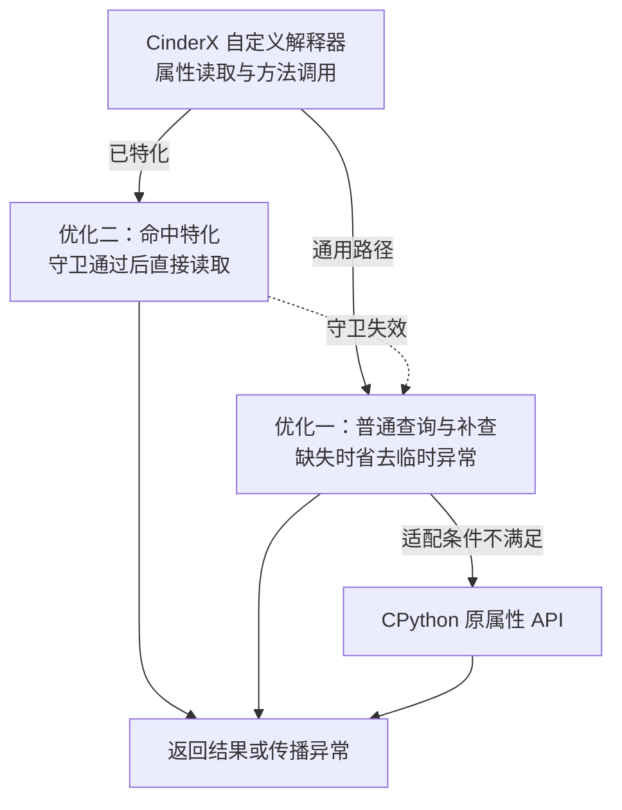

# 【性能】CPython 3.11.6 属性访问路径优化技术方案（RFC）

**状态 (Status):** Draft v0.12

**作者 (Authors):** @qq_16646553

**创建日期 (Created):** 2026-10-26

**更新日期 (Updated):** 2026-11-02

**相关 Issue/PR:** 待关联

---

# 1. 概述

本方案面向 CPython 3.11.6，通过 CinderX 自定义解释器加速属性访问。目标对象使用默认的 `__getattribute__`，并通过 `__getattr__` 完成缺失后的补查。优化分为两项：

1. **查询缺失时减少异常开销**：省去用于中转的临时 `AttributeError`，继续调用原 `__getattr__`。
2. **查询命中时加快读取**：使用带守卫的特化路径，减少普通属性和方法的通用查询，以及直接调用方法时的绑定对象分配。

属性查找顺序、描述符和异常处理遵循原规则，属性或类型变化后，后续读取按新定义执行。通过类型和存储检查的访问使用快路径，其余访问沿用原协议。

方案依据通用的 Python 对象协议实现，通过 CinderX 扩展包交付。系统 CPython 和应用源码保持原样，JIT 保持关闭。

首期支持范围以验收通过的环境清单为准。功能默认关闭，显式启用时完整开启；初始化失败时报错并终止本次启动。本期验收实现正确性、基本功能及十模型运行，业务性能验收后续补充。安装和使用方法见 **3.5**。

# 2. 用例分析

## 2.1 PyTorch 案例：正常属性读取中的临时异常

此前在 CPython 3.11 上分析 PyTorch eager 算子下发时，发现部分参数读取反复触发异常构造和内存分配。以 `module.weight` 为例，`weight` 通常保存在 `_parameters` 参数注册表中，普通字段 `training` 则直接保存在实例字典中：

```python
# module.__dict__ 的相关内容，仅示意存储关系
{
    "training": False,                         # 普通字段
    "_parameters": {"weight": parameter_obj},  # 参数注册表
}
```

读取 `module.weight` 时，原路径为：

```text
普通属性查询未命中
    → 构造临时 AttributeError
    → 清除异常，调用原 Module.__getattr__
    → 从 _parameters 找到并返回 weight
```

一次成功的读取因此包含了临时异常的构造和清除。热点栈中的 `PyErr_Format`、`PyUnicode_FromFormatV` 和 `_PyObject_Malloc` 对应错误消息格式化和临时对象分配；频繁读取参数时，这部分开销会反复出现。

优化一在满足条件时省去中间异常，继续由原 `Module.__getattr__` 从注册表取值。优化二面向 `module.training` 这类普通字段命中和直接方法调用，减少通用查询成本。两项改动都在解释器内完成，模型源码和注册表保持原样。

## 2.2 代表性工作负载

选取以下10个模型，覆盖特征交互、多任务和序列推荐。模型实现沿用同一版本的RecSDK；需要固定的可调运行参数见附录A。

| 模型 | 类型 | Batch |
|---|---|---:|
| DLRM | 特征交互 | 128 |
| AutoInt | 注意力特征交互 | 128 |
| MMOE | 多任务 | 128 |
| ESMM | 多任务 | 128 |
| ETA | 行为序列 | 128 |
| DIEN | 兴趣演化 | 128 |
| SASRec | 序列推荐 | 128 |
| DCNv2 | 特征交叉 | 128 |
| HLLM | 分层LLM推荐 | 128 |
| GR 2B | HSTU序列推荐 | 1 |

GR 2B使用直接HSTU入口，不包含完整vLLM服务链路。

# 3. 方案设计

## 3.1 总体方案

### 3.1.1 设计基线与职责边界

方案以 **CPython 3.11.6** 为基线，通过 CinderX 已有的 PEP 523 求值接口接入解释器循环。

**CinderX 负责属性查询适配和属性、方法特化；宿主 CPython 负责对象、类型、引用计数和异常状态。** 用户类型的属性入口保持原样，属性值按当前对象状态读取，补查结果按本次调用返回。

首期支持范围以验收通过的环境清单为准。清单记录 Python 版本、源码与构建标识、操作系统、架构、ABI，以及解释器和求值器配置。主／子解释器、trace/profile 等执行组合分别记录验证状态；新增版本、平台或组合通过验证后纳入支持清单。

### 3.1.2 总体架构

两项优化都位于 CinderX 自定义解释器中，分别减少**命中时的查询成本**和**缺失后补查的异常成本**。



特化路径根据缓存和守卫读取当前值。通用路径先检查适用条件，再执行普通查询；需要补查时调用原 `__getattr__`。适配条件不满足的访问交给原属性 API 处理。

### 3.1.3 接入与覆盖范围

在 CinderX 解释器内部，为 `PyObject_GetAttr` 和 `_PyObject_GetMethod` 的相关调用接入属性适配层，处理 `LOAD_ATTR`、`LOAD_METHOD` 及其特化形式。

进入这些入口并通过适用条件检查的访问使用优化路径，其余情况直接调用宿主原属性 API。内建 `getattr()`、`hasattr()` 和 C 扩展直接调用宿主 API 的访问，继续使用现有实现。

## 3.2 技术选型

核心选择如下：

| 设计点 | 选择与作用 |
|---|---|
| 缺失后补查 | 复用现有异常抑制接口，省去中转异常，继续调用原 `__getattr__` |
| 普通命中 | 扩大现有属性和方法特化的适用范围，加快读取和直接调用 |
| 状态变化 | 复用原有守卫和失效机制，条件变化时回到原属性协议 |

具体的查询、引用和回退规则见 3.3。

## 3.3 功能与性能设计

### 3.3.1 共同的对象资格判定

#### 3.3.1.1 适用的类型

对象的类型必须**保留默认的 `__getattribute__`，并提供 `__getattr__` 用于缺失后的补查**。这两个方法可以来自继承。具体检查如下：

1. 实际 `tp_getattro` 为认可的原生 `slot_tp_getattr_hook`。
2. 经类型及其 MRO 查找，`__getattribute__` 仍是 `object.__getattribute__`。
3. 经类型及其 MRO 查找，能够找到 `__getattr__`。

三项检查一起确认对象采用“默认读取＋缺失后补查”的访问方式。自定义 `__getattribute__` 的类型继续按自身协议执行。

初始化时，从内建 `object` 类型取得默认 getter，并获取原生 hook 指针。运行时使用 `_PyType_Lookup` 等内部接口核对类型定义，检查范围限于相关方法和入口；用户回调仍由实际属性查询按原规则执行。

首期支持上述原生 hook。其他 C getter 的接入另行确定访问语义和生命周期要求。

#### 3.3.1.2 类型资格与实例存储检查

通过类型检查后，还需确认当前实例满足对应路径的读取条件。**普通查询适配和命中特化都要保证查询结果、异常及用户回调行为与原协议一致。**

| 路径 | 检查时机 | 核对内容 |
|---|---|---|
| 普通查询与补查 | 每次进入通用适配时 | 属性名称、访问入口、当前类型与实例状态，以及查询的语义等价条件 |
| 属性／方法特化 | 自适应指令尝试特化时 | 类型资格、描述符分类、实例状态和原有缓存证据 |
| 已特化的读取 | 每次执行特化指令时 | 原有版本、实例状态、名称和空值守卫 |

属性名不是精确 Unicode 对象，或当前实例的查询行为无法确认等价时，在普通查询前回到原 API。检查使用内部状态信息完成，保留查询期间状态变化的处理要求；查询完成后根据返回状态继续，避免重复执行用户回调。handler 按单次访问管理。

### 3.3.2 优化一：消除普通未命中的临时异常

本优化同时改变**普通查询如何报告缺失**和**上层如何判断需要补查**：将“返回NULL并设置AttributeError，再识别和清除异常”改为“内部查询返回NULL且没有异常，直接补查”。这两处必须一起修改，原 `__getattr__` 的逻辑保持不变。

#### 3.3.2.1 原路径为什么产生临时异常

`PyObject_GenericGetAttr` 是普通属性查询接口，其约定是找到属性就返回值，找不到就报告异常。它不负责判断外层是否还会补查。CPython 3.11.6中的实现调用：

```c
return _PyObject_GenericGetAttrWithDict(obj, name, NULL, 0);
```

最后一个参数为 `suppress=0`，要求普通缺失设置异常。外层 `slot_tp_getattr_hook` 再根据异常决定是否调用 `__getattr__`。仅保留默认getter分支时，核心逻辑为：

```c
res = PyObject_GenericGetAttr(obj, name);
if (res == NULL && PyErr_ExceptionMatches(PyExc_AttributeError)) {
    PyErr_Clear();
    res = call_attribute(obj, handler, name);
}
```

第一行执行普通查询；条件判断确认是属性缺失；清除异常后，最后一行绑定并调用补查函数。若补查成功，中间异常只承担“普通查询没找到”的通知作用，却已经付出了消息格式化、异常上下文处理及对象创建释放的成本。

**语言语义并不要求补查前一定创建异常；这是原接口组合传递缺失状态的方式。**

#### 3.3.2.2 改动一：使用无异常缺失接口

仅在通过3.3.1的类型和实例存储检查后，适配层改为直接调用内部接口：

```c
res = _PyObject_GenericGetAttrWithDict(obj, name, NULL, 1);
```

普通查找仍按原顺序执行。差别发生在查找结束、确实没有找到属性时：

```c
if (!suppress) {
    PyErr_Format(PyExc_AttributeError,
                 "'%.50s' object has no attribute '%U'",
                 tp->tp_name, name);
    set_attribute_error_context(obj, name);
}
```

`suppress=1`使这段默认缺失异常的构造被跳过，直接返回“NULL且没有异常”。对于普通缺失，省去的是异常的产生过程，而非产生之后再忽略。

描述符自身抛出的 `AttributeError` 可能已经创建异常对象，其处理仍须符合原slot语义；不能宣称这类异常也全部免于构造。其他错误必须保留并传播。

#### 3.3.2.3 改动二：同步修改补查判断

查询不再产生默认缺失异常后，原来的 `PyErr_ExceptionMatches(AttributeError)` 条件不会成立。因此调用者必须同步改为：

```c
if (res == NULL && !PyErr_Occurred()) {
    /* 按原规则绑定并调用 __getattr__。 */
}
```

完整分流如下：

| 查询结果 | 处理 |
|---|---|
| `res != NULL` | 普通查询成功，返回查得的值 |
| `res == NULL && !PyErr_Occurred()` | 没有结果且没有待传播异常，调用补查 |
| `res == NULL && PyErr_Occurred()` | 查询仍有错误，直接传播，不调用补查 |

普通缺失路径没有中间异常，因此无需再执行外层 `PyErr_Clear()`。但不能只修改`suppress`而保留旧判断，也不能对所有NULL结果都调用补查。一次查询完成后不重查；例如property抛 `ValueError`，应只执行一次并直接传播错误。

#### 3.3.2.4 保留补查调用、引用管理和最终异常

以下伪代码展示整体顺序，helper的失败处理和绑定细节仍须遵循原API契约：

```c
if (!eligible_type_and_storage(obj, name)) {
    return original_getattr(obj, name);
}

handler = lookup_getattr(Py_TYPE(obj));
/* 确认handler有效后，在可能执行描述符之前持有强引用。 */
Py_INCREF(handler);

res = _PyObject_GenericGetAttrWithDict(obj, name, NULL, 1);
if (res == NULL && !PyErr_Occurred()) {
    res = bind_and_call_getattr(handler, obj, name);
}

Py_DECREF(handler);
if (res == NULL) {
    preserve_attribute_error_context(obj, name);
}
return res;
```

- **查询前持有handler：** 描述符可能删除或替换类型上的 `__getattr__`，本次访问仍须使用原slot规定的handler快照，避免悬垂引用或行为改变。
- **按原规则绑定：** 沿用3.11.6 `call_attribute` 的语义，有 `tp_descr_get` 时先绑定，没有时直接调用；不假设handler必然是普通Python函数。
- **正确释放引用：** handler、临时绑定对象和结果分别管理，成功和失败分支都释放自身持有的引用。
- **保留最终异常：** 补查失败时，异常类型、消息、异常链及必要的 `AttributeError.name/obj` 保持原规则，不无条件覆盖已有信息。补查结果不复制、不持久缓存。

#### 3.3.2.5 守卫与解释器入口接入

上述改动位于 CinderX 解释器内部，宿主 `PyObject_GenericGetAttr` 保持原行为。满足 3.3.1 条件的访问使用适配入口，其余访问直接调用原 API。

`_PyObject_GetMethod` 还需要说明调用时是否额外传入 `self`。本通用路径返回完整的属性值，需要调用时直接使用这个结果，不再补一个 `self`。结果可以是绑定方法，也可以是 `__getattr__` 返回的其他可调用对象。

### 3.3.3 优化二：普通属性与方法命中特化

#### 3.3.3.1 特化器放行规则

CPython 3.11.6 的 `analyze_descriptor()` 会检查类型的属性访问入口。对于定义了 `__getattr__` 的类型，入口通常是 `slot_tp_getattr_hook`；即使它仍使用默认的 `__getattribute__`，也会因入口不同而被拒绝特化。

**改动前：CPython 3.11.6 原代码**

位置：[`Python/specialize.c` 的 `analyze_descriptor()`](https://github.com/python/cpython/blob/v3.11.6/Python/specialize.c#L509-L524)。下面摘录 `store == 0` 时的读取分支；写入分支由前面的 `if (store)` 单独处理。

```c
if (type->tp_getattro != PyObject_GenericGetAttr) {
    *descr = NULL;
    return GETSET_OVERRIDDEN;
}
```

**改动后：本方案在 CinderX 副本中的修改示意**

```c
if (type->tp_getattro != PyObject_GenericGetAttr &&
    !is_supported_attr_type(type)) {
    *descr = NULL;
    return GETSET_OVERRIDDEN;
}
```

`is_supported_attr_type()` 表示 3.3.1.1 的三项类型检查：入口为认可的原生 hook，`__getattribute__` 使用默认实现，并能找到 `__getattr__`。它是本方案的辅助函数示意名称。

两段代码的差别只有一项：**入口虽与 `PyObject_GenericGetAttr` 不同，但通过上述检查的类型，可以继续参与特化分析。** 自定义 `__getattribute__` 等其他类型仍使用通用路径。

改动限于读取分支，`STORE_ATTR` 的 `tp_setattro` 检查及后续写入规则保持原样。类型放行后，继续执行原有描述符分类：数据描述符仍优先于实例属性，property 等形态沿用原实现的支持范围。具体访问能否特化，还需通过原有实例状态和缓存检查。

#### 3.3.3.2 读取与回退要求

通过分析后，复用现有属性和方法特化指令及其缓存布局。属性读取保留类型版本、当前实例状态、名称和空值检查；方法调用同时检查方法缓存及实例上的同名属性是否遮蔽了方法。

特化路径读取当前实例的当前值，属性赋值后立即可见。守卫失效时，回到通用查询，动态变化的处理见 3.3.4。

引用管理沿用原指令的顺序：先持有结果，再替换栈顶并释放 owner，兼顾析构和重入。具体存储布局及取值实现另行说明。

#### 3.3.3.3 方法读取与直接调用

`obj.method(...)` 可由 `LOAD_METHOD` 及其特化形式提供 callable 和 self，再由原 3.11.6 调用协议执行。守卫满足时，可以省去通用查询和中间绑定方法对象。

`f = obj.method` 则按 `LOAD_ATTR` 语义返回可保存的属性对象，后续使用方式保持原样。

### 3.3.4 动态失效与回退契约

只有当前证据足以证明与完整查询等价时，才走快路径。

| 动态变化 | 快路径处理 | 回退后的行为 |
|---|---|---|
| 修改已有实例值 | 从当前槽位或 values 取值 | 不缓存旧结果 |
| 删除实例属性、清空 slot | 空值、键或其他原守卫失败时退出 | 按原规则查找、补查或抛错 |
| 新增数据描述符 | 类型版本失效 | 恢复描述符优先级 |
| 替换 `__getattr__` / `__getattribute__` | 类型版本失效；通用入口重查资格 | 使用修改后的协议 |
| 修改 `__bases__` | 复用类型及派生类型失效规则 | 使用当前 MRO |
| 修改 `obj.__class__` | 当前类型不满足旧证据 | 按新类型查询 |
| 替换实例存储 | 当前实例状态或缓存证据失效 | 执行完整属性查询 |
| 实例字段遮蔽方法 | 原方法守卫失效 | 返回或调用实例上的同名值 |

类型版本为 0、缓存条件不成立或版本资源不可用时，沿用原有拒绝特化和回退规则，不截断版本号或复用过期证据。

守卫失败不一定立即重写 opcode；遵循 3.11.6 自适应机制的失败计数、通用执行和重新特化规则。

**运行时不适用属于正常情况。** 回退后继续执行原属性协议，不因一次未命中守卫而报启用失败，也不全局停用功能。初始化失败的处理见 3.3.6。

### 3.3.5 性能设计

本节说明拟减少的成本和实现约束，**不设置本期量化性能验收指标**。

#### 3.3.5.1 成本消减构成

| 路径 | 主要消减项 | 保留的成本 |
|---|---|---|
| 普通缺失后补查成功 | 临时缺失异常的构造、格式化、清除及对象周转 | 资格检查、普通查询、handler 绑定与调用 |
| 实例字段命中特化 | 重复通用查找和 hook 调度 | 类型/布局守卫、当前值读取、引用处理 |
| 直接方法调用命中特化 | 通用查询及可省略的绑定对象分配 | 方法守卫和原调用协议 |

```text
未命中原路径 = 普通查询 + 临时异常构造与清除 + 补查调用
未命中优化后 = 资格检查 + 可抑制缺失的普通查询 + 补查调用

普通命中原路径 = hook 入口 + 通用查询 + 绑定或引用处理
命中特化后     = 版本与布局守卫 + 定位读取 + 必要的调用/引用处理
```

两项功能作用于不同访问集合。不能将单次未命中收益套到全部属性访问，也不能将局部成本消减等同于程序总耗时下降。

#### 3.3.5.2 控制新增开销

新增检查应保持轻量，避免抵消省下的查询成本。优化二在尝试特化时完成类型和描述符分析，后续命中时复用原 inline cache，执行必要的守卫、取值和引用处理；优化一的通用适配仍按 3.3.1 检查当前访问。原生规则已支持的类型沿用原检查，诊断统计默认关闭。

#### 3.3.5.3 两项功能的协同

普通命中且缓存稳定时，由优化二直接返回；尚未特化或守卫失败时进入通用路径。符合优化一资格时执行三态查询，状态要求补查时才调用 `__getattr__`；否则使用原 API。

两项功能都不省略用户自己的补查计算，不缓存补查结果，不改变属性值存储位置。

### 3.3.6 初始化、配置与生命周期

**对外使用 `ATTR_PATH_MODE` 作为启动开关，默认值为 `off`。** 设置为 `cinderx` 时，完整开启两项优化及所需的读取与回退支持，并保持 JIT 关闭。业务用户不需要组合内部开关；具体用法和接口来源见 3.5。

初始化在安装或切换 evaluator 前完成：读取配置、检查支持环境与入口所有权、获取默认 getter 和原生 hook、确认内部接口可用。探针类型只允许在此阶段创建并释放。

| 场景 | 行为 |
|---|---|
| 未显式启用 | 本功能不改变已有求值入口和属性处理路径；安装 wheel 本身不自动启用 |
| 显式启用且检查通过 | 按既有所有权协议完整启用，并提供可查询的实际状态 |
| 显式启用但初始化失败 | 明确报告原因，使本次启用失败；不静默退回，不将部分功能标为已启用 |
| 运行时对象或守卫不适用 | 正常回到原属性协议，继续业务执行 |
| 内部诊断关闭某一优化 | 只改变优化选择，不得关闭正确性守卫；不适用的布局使用安全原路径 |

所有初始化检查通过前，不发布已启用状态，不替换原求值入口。失败时清理本次持有的资源，保持原入口不变；业务启动器必须将显式启用失败作为失败处理，不能吞掉错误继续报告成功。

不覆盖未知第三方 evaluator。若 CinderX 已因其他功能安装，关闭本属性优化只表示恢复其原属性处理路径，**不等于卸载整个 evaluator**。

功能配置在初始化时确定，模式切换使用新进程。不新增运行中热卸载、热切换或跨 evaluator 接力。内部细分开关仅供诊断，各配置下都保留正确读取与安全回退所需的检查。

### 3.3.7 代码组织与改动范围

| 模块 | 职责 |
|---|---|
| `cinderx/Interpreter/3.11/` 属性适配层 | 资格检查、三态查询、handler 绑定、异常上下文和引用清理 |
| `specialize_wrapper.c` 及资格 helper | 类型条件检查、初始化依赖、原生 hook 识别 |
| `specialize.c` 对应补丁 | 读取资格判定，保留原描述符分类和写入行为 |
| `ceval.c` 对应补丁 | 特化指令取值与执行期守卫 |
| `ceval_wrapper.c` | 解释器局部属性 API 映射与循环接入 |
| 初始化与配置模块 | 开关、支持检查、失败处理及 evaluator 所有权 |

CPython 3.11.6 原始快照保持不变。改动以独立补丁管理，在构建目录生成副本并核对输入/输出一致性，再编译到扩展中。其他 Python 版本通过版本目录和编译边界隔离。

本功能不引入新的帧表示、调用协议、全局变量缓存或 JIT 代码生成逻辑。

## 3.4 安全隐私与 DFX 设计

| 维度 | 设计要求 |
|---|---|
| 正确性 | 返回值、异常状态和引用所有权一致；不支持形态使用原协议 |
| 兼容性 | 只承诺已列出且验证的环境；保留原 trace/profile 分派规则 |
| 可靠性 | 显式启用失败明确报错，无部分启用；运行时不适用正常回退 |
| 可维护性 | 两项功能独立组织，复用原分类、缓存与失效机制，检查共享 helper 的全部影响范围 |
| 可诊断性 | 状态可查询；可选记录补查、错误传播、守卫失败及特化状态，不默认采集属性值 |
| 可配置性 | 对外一个默认关闭的入口，启用时完整开启；细分开关仅用于内部诊断 |

“返回 NULL 且无异常”不必然是纯字典未命中，也可能来自按规则抑制的描述符 `AttributeError`；计数名称和解释必须保留这一区别。诊断接口与正常性能路径分离，不要求业务方理解内部计数。

## 3.5 安装、启用与状态检查

通过匹配CPython 3.11.6的wheel交付，不修改应用源码。功能默认关闭；显式启用时完整开启两项优化及所需的读取与回退支持，JIT保持关闭。交付包提供以下接口：

```bash
PY=/path/to/cpython-3.11.6/bin/python3.11
WHEEL=/path/to/cinderx.whl  # 替换为实际交付文件

# 安装：使用同一Python环境，依赖预先准备。
ATTR_PATH_MODE=off "$PY" -m pip install --no-index --no-deps "$WHEEL"

# 启用或关闭：分别启动新进程。
ATTR_PATH_MODE=cinderx "$PY" app.py
ATTR_PATH_MODE=off "$PY" app.py

# 状态检查。
ATTR_PATH_MODE=cinderx "$PY" -c 'import _cinderx_auto; print(_cinderx_auto._verify())'
```

`_verify()`应确认预期evaluator、两项优化及其依赖的读取支持已开启，JIT配置关闭且相关计数为零；状态不符时非零退出。独立检查只证明该进程的状态，验收还需记录实际应用进程的启用状态。

启动接口依赖`.pth`，不使用`python -S`跳过site处理。初始化失败处理及已有evaluator的所有权遵循3.3.6；关闭本功能不等于卸载其他配置安装的evaluator。

## 3.6 可验证性与验收设计

以原生CPython 3.11.6为语义基准。模型对照使用同一CPython 3.11.6（PGO＋LTO）构建及依赖，分别关闭、开启本功能；保持相同权重、输入和运行配置。全部使用推理模式、纯eager，关闭梯度、graph、compile和JIT。

| 验证项 | 要求 |
|---|---|
| 启用与关闭 | 默认关闭；显式启用时两项功能完整生效；初始化失败明确退出，不部分启用 |
| 功能正确性 | 属性命中、缺失补查、描述符、异常及方法绑定与原生语义一致；动态变异后正确失效和回退，无引用生命周期错误 |
| 路径覆盖 | 覆盖冷态、预热和变异；以指令状态或测试计数证明两项快路径及回退实际执行 |
| 十模型运行 | 参数符合附录，完成真实前向；两组输出结构、shape、dtype一致，数值满足预先确定的精度要求 |
| 可复现性 | 保存源码/构建版本、实际参数、启用状态、运行命令及原始结果；失败、未执行和不适用分别记录 |

性能评价以后续ARM＋NPU实机的FREE时间为主，使用统一采集口径、固定预热和交错重复测量，计时期间关闭诊断。本期不新增量化性能门槛。

# 4. 缺点和风险

| 主要风险 | 处理方式 |
|---|---|
| **换 Python 版本可能不能直接使用** | 当前按 3.11.6 实现，其他版本需重新适配和验证。 |
| **属性变化或异常处理不当，可能返回错误结果** | 保留必要检查和原有异常处理；不满足优化条件就走原路径。 |
| **启用失败却继续运行，容易误以为加速已生效** | 明确报错退出，不允许部分开启；提供实际状态检查。 |
| **部分访问没有收益，检查本身也有开销** | 只优化前文列出的访问路径，不承诺所有程序都变快；性能后续验收。 |

# 5. 现有技术

方案复用 PEP 523 的求值器接入和 PEP 659 的自适应特化机制。后续 CPython 属性优化作为设计参考，不直接等同于本方案的 3.11.6 回移实现；异常和动态变异行为仍需按 3.6 差分验证。

| 参考 | 借鉴内容 | 本方案边界 |
|---|---|---|
| [PEP 523：Frame evaluation API](https://peps.python.org/pep-0523/) | 求值器接入 | 沿用 CinderX 既有所有权协议 |
| [PEP 659：Specializing Adaptive Interpreter](https://peps.python.org/pep-0659/) | 自适应特化及守卫 | 保留 3.11.6 的 opcode 和缓存布局 |
| [CPython 属性特化改动](https://github.com/python/cpython/commit/7276ca25f5f1440aa4d025350d3de15141854dde) | 属性协议与特化资格的分析思路 | 仅扩大本方案允许的读取资格，不支持任意自定义 getter |
| [CPython 补查异常处理改动](https://github.com/python/cpython/commit/59c27fa5cb95e2d608747a50fc675bbe2fc96beb) | 抑制中间缺失异常并按需补查 | 单独验证 3.11.6 的异常、实例状态变化和 handler 生命周期 |

---

# 附录A：模型运行配置记录

模型采用 RecSDK `develop_torch_benchmark`，提交为 `566af0c556da3430598f09a273e6298804a22c69`。HLLM、GR依赖的外部源码与模型配置随配套交付包固定。本附录记录十个模型的运行配置，具体启动与验收操作见交付包。

## A.1 十模型通用配置

| 项目 | 设置 |
|---|---|
| 环境 | Linux ARM64＋Ascend NPU；CPython 3.11.6（PGO＋LTO） |
| 软件栈 | Torch 2.10.0+cpu、torch-npu 2.10.0.post4、CANN 9.1.0 |
| 执行模式 | eval/no_grad、纯 eager；compile、graph、JIT关闭；前向入口按各模型配置 |
| Batch与随机种子 | 默认Batch128、seed=2025；HLLM使用seed=2020，GR使用Batch1、seed=42；同一模型A/B使用相同权重和输入 |
| 输入与资产 | 按模型使用原生成器或已有数据资产，固定输入规模；每次A/B重放同一份权重、输入及所需缓存 |
| 精度 | 默认FP32权重、HF32开启；HLLM当前已验证配置为FP32、HF32开启、autocast关闭；GR采用FP32 Embedding＋BF16主体及预测头 |
| 其他设置 | Q1；pymalloc；GC开启；静态TLS可选配额512字节；绑核按现场site配置 |
| 性能采集 | 三块ABBA→BAAB→ABBA；每进程50+50次预热，两段各400次CLEAN，独立Card取20个有效step |
| 指标与质量策略 | FREE=本进程CLEAN E2E均值−独立Card；默认 `WINDOW_COMPARABLE`，逐step差异单独标注 |

## A.2 各模型配置

RecSDK入口路径相对于 `rec_model_zoo_pytorch/`；HLLM、GR的依赖源码入口另行注明。下文 `E` 为 Embedding 维度，`E循环`表示按字段循环采用 `[8,16,32,64,128]`；`宽度×层数`表示连续相同宽度的隐藏层。层宽按原入口处理后的实际值记录。

### A.2.1 DLRM

Embedding与MLP结合的特征交互模型，将稀疏特征分组聚合后与稠密特征进行点积交互。

- **入口**：`feature_interaction/dlrm.py`，运行模式为`test_qps`。
- **规模**：E8，field1000，vocab5000；每20字段一组，共50组。
- **结构**：Dense MLP为 `1000 → 6144×6 → 3072×3 → 1536×3 → 8`；固定源码的预测头为 `Linear(166472, 1)`。
- **交互维度**：Embedding表为`[5000,8]`；50组稀疏特征形成400维表示，与8维稠密表示拼接成408维后进行交互。
- **输入**：`feat_ids [128,1000] int64`，ID范围`[0,32)`；`feat_vals [128,1000] FP32`，取值范围`[0,1)`。
- **输出**：`ctr [128] FP32`。

### A.2.2 AutoInt

基于多层自注意力的特征交互模型，特征嵌入与数值特征相乘后，经过注意力层、展平和全连接输出。

- **入口**：`feature_interaction/autoint.py`，运行模式为`test_qps`。
- **规模**：E128，field300，vocab10000，extra_fields=0。
- **结构**：Embedding表为`[10000,128]`；8层注意力、8头，每头维度16，保留原`batch_first=False`；输出层为`Linear(38400, 1)`。
- **其他参数**：`attention_dim=16`、`max_seq_len=100`；实际输入宽度由`field_size=300`决定，原入口的模块级`params`保持不变。
- **输入**：`feat_ids [128,300] int64`，ID范围`[0,32)`；`feat_vals [128,300] FP32`，取值范围`[0,1)`。
- **输出**：`ctr [128] FP32`。

### A.2.3 MMOE

多任务、多专家推荐模型，任务通过各自的gate组合共享专家输出，再进入对应tower。

- **入口**：`behaviour_and_multi_task/mmoe.py`，运行模式为`test_qps`。
- **规模**：E循环，extra_fields=300，8 experts，reuse_hash=True，hash_bits=32。
- **结构**：Expert隐藏层 `4096×3 → 2048×3 → 1024×3 → 512×3`；Tower隐藏层 `2048×3 → 1024×3 → 512×3 → 256×3`。
- **字段定义**：使用`datasets/aliccp/spec.json`和原扩展逻辑；`field_size=39`是基础配置，最终字段数及每字段词表以展开后的spec为准。
- **输入**：原Aliccp字典，字段及词表按`spec.json`展开；单值`[128]`、多值`[128,50]`、special`[128,38]`，均为int64。
- **输出**：`ctr [128] FP32`、`ctcvr [128] FP32`。

### A.2.4 ESMM

双塔多任务推荐模型，关联点击与转化预测，返回ctr和ctcvr两路输出。

- **入口**：`behaviour_and_multi_task/esmm.py`，运行模式为`test_qps`。
- **规模**：E循环，extra_fields=200，reuse_hash=True。
- **结构**：双tower，隐藏层为 `6144×4 → 3072×4 → 1536×4 → 768×4 → 384×4`。
- **输入**：原Aliccp字典，字段及词表按`spec.json`展开；单值`[128]`、多值`[128,50]`、special`[128,38]`，均为int64。
- **输出**：`ctr [128] FP32`、`ctcvr [128] FP32`。
- **状态特性**：Embedding模块保存在普通字典中；保持原结构，字典内权重也随模型状态一起保存和回放。

### A.2.5 ETA

基于行为序列的推荐模型，包含hash检索、top-k筛选和候选相关注意力计算。

- **入口**：`behaviour_and_multi_task/eta.py`，运行模式为`test_qps`。
- **规模**：E循环，extra_fields=15，序列长度50，4头，topk=8，hash_bits=128，reuse_hash=True。
- **结构**：Deep隐藏层 `12288×4 → 6144×4 → 3072×4 → [1536,1536,1596,1536] → 768×4`，保留其中的1596。
- **输入**：原Aliccp字典，字段及词表按`spec.json`展开；单值`[128]`、多值`[128,50]`、special`[128,38]`，均为int64。
- **输出**：`ctr [128] FP32`。
- **状态特性**：`long_attention.reuse_hash`作为持久Tensor保存；`masks/emb_cats`由每次前向重新生成。

### A.2.6 DIEN

通过循环结构与注意力刻画用户兴趣演化的序列推荐模型，保留原长度50的序列处理路径。

- **入口**：`behaviour_and_multi_task/dien.py`，运行模式为`test_qps`。
- **规模**：E32，extra_fields=100，序列长度50，reuse_hash=True，hash_bits=32。
- **结构**：DNN隐藏层 `2048×4 → 512×4 → 256×4`；Attention隐藏层 `2048×4 → 512×4 → 256×4 → 128×4 → 32×4`，使用原MyGRU前向。
- **输入**：原Aliccp字典，字段及词表按`spec.json`展开；单值`[128]`、多值`[128,50]`、special`[128,38]`，均为int64。
- **输出**：`ctr [128,1] FP32`。
- **初始化**：首个前向前使用原`MyGRU.reset_parameters()`初始化相关权重，随后冻结供A/B共同使用；派生的`aux_loss`仍在前向中生成。

### A.2.7 SASRec

基于自注意力的序列推荐模型，对每条长度150的用户序列计算101个候选物品的得分。

- **入口**：`behaviour_and_multi_task/sasrec.py`，运行模式为`test_qps`。
- **规模**：E32，maxlen=150，16 blocks，4头，norm_first=False，dropout=0.2（eval）。
- **词表**：`item_num`取所选`ml-1m.txt`的最大物品ID，Embedding行数为`item_num+1`；数据SHA和实际行数随运行记录。
- **输入**：`seq/user_ids [128,150] int64`，`item_ids [128,101] int64`；原生成器ID范围`[0,3416)`。
- **输出**：`ctr [128,101] FP32`。
- **数据特性**：`ml-1m.txt`决定词表规模，计时输入仍由原`TestML1MHandler`随机生成；位置Embedding为`[151,32]`。

### A.2.8 DCNv2

交叉网络与深层网络结合的推荐模型，处理multi-hot稀疏特征与13维稠密特征。

- **入口**：`feature_interaction/dcn_v2_multihot.py`，运行模式为`test_qps`，验收名称为`dcn_v2`。
- **规模**：E循环，156个multi-hot字段，12层cross，projection=1024。
- **结构**：Deep隐藏层 `4096×3 → 2048×3 → 1024×3 → 512×3 → 256×3`；Predict层宽 `4096×3 → 2048×3 → 1024×3 → 512×3 → 2`。
- **输入**：`feat_ids [128,1284] int64`，ID按各字段词表取值；`feat_vals [128,13] FP32`。
- **输出**：`ctr [128,2] FP32`。
- **字段与状态**：26种multi-hot长度循环6次，拼接宽度为1284；156张Embedding表保留在原普通列表中，全部随模型状态保存和回放。

### A.2.9 HLLM

结合物品与用户侧语言模型的推荐模型，复用已有物品特征缓存，对用户历史序列进行全商品打分。

- **入口**：RecSDK的`HLLM/`适配；依赖源码中调用`TrainerNPU._full_sort_batch_eval`，stage=2，经`model(..., mode="predict")`执行原预测路径。
- **规模**：Batch128，用户历史长度10，物品文本长度上限256，seed=2020；数据配置的物品数为686624。
- **结构与精度**：item/user LLM均为22层，hidden=2048，intermediate=5632，32个attention heads、4个KV heads，vocab=32000；当前已验证配置为FP32、HF32开启、autocast关闭，`use_ft_flash_attn=False`。
- **资产与计时**：使用匹配的HLLM checkpoint、item/user预训练资产、数据集及item_feature缓存；权重和缓存准备在计时外完成，保留原前向内的搬运与屏蔽处理。
- **输入**：用户物品ID为`[128,10] int64`；时间特征为`[128,10,6] int64`，最后一维依次为年、月、日、时、分、秒；附带历史及正样本索引；item_feature为`[686624,2048] FP32`。
- **输出**：`scores [128,N]`及正样本索引，当前已验证得分dtype为FP32；保留padding和历史物品位置的`-inf`屏蔽值。

### A.2.10 GR 2B

基于HSTU的序列推荐模型，采用直接模型eager forward场景，包含Embedding、序列处理和候选打分。

- **入口**：HSTU依赖源码中的`benchmark/inference_benchmark_2b_random.py`，调用`InferenceRankingGR.forward(batch, uids)`；验收名称为`gr_2b`。
- **规模**：Batch1，24层，hidden=4096，16头、head_dim=256，实际tokens=2048，候选数100；`full_mode=True`，MoE/FFN/RAB关闭。
- **结构与精度**：item Embedding为`[1000000,4096] FP32`，action Embedding为`[512,4096] FP32`；HSTU及预测头为BF16。模型结构和输入生成参考原benchmark，实际验收使用固定适配源码，将HSTU调用绑定到`torch.ops.mxrec.hstu_jagged.equal`；OFF/ON共用同一适配基线。
- **权重来源**：`USE_RANDOM_PARM=1`，seed=42，按`uniform[-0.5,0.5]`初始化；生成后冻结，供OFF/ON共同回放。
- **输入**：原Batch/JT/KJT结构，包含974个历史item、974个action和100个候选；video_id values为`[1074] int64`，action_weights values为`[974] int64`，uids为`[1] int64`；长度与offset等元数据由原生成器产生。
- **输出**：候选得分Tensor，shape为`[100,1]`，dtype为BF16。
